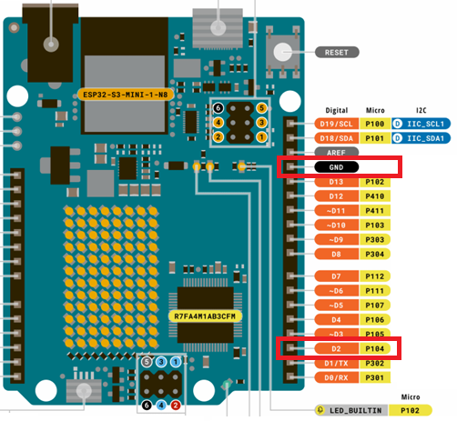

<!--
  手順書テンプレート(全ボード共通)
  - このファイルをコピーして、ボードごとのフォルダに保存してから書き始める。
  - 章の番号と名前は変えない。該当しない章は消さずに「本ボードでは作成しない(理由:〜)」と書く。
  - ボード独自の内容は、第9章以降に追加章として書く。
  - このコメントはプレビューには表示されない。消さずに残してよい。
-->

# 【Arduino UNO R4 WiFi】開発手順書

| 項目 | 内容 |
|---|---|
| 対象ボード | |
| 開発言語 | |
| IDE・ツール | (名称とバージョン) |
| SDK・ライブラリ | (名称とバージョン) |
| 開発PCのOS | (例:Windows 11 24H2) |
| 最終検証日 | (yyyy/mm/dd) |

## 改版履歴

| 版 | 日付 | 担当者 | 内容 |
|---|---|---|---|
| 0.1 | (yyyy/mm/dd) | | 新規作成 |

---

## 0. 概要

### 0.1 この手順書でできること
<!-- 読者がこの手順書を最後まで進めると何ができるようになるかを書く -->

### 0.2 必要な機材

| 品名 | 数量 | 備考 |
|---|---|---|
| | | |

### 0.3 前提知識・事前準備
<!-- 既存の Git/GitHub 運用・Redmine 運用を参考に、前提とする知識と準備を書く -->

---

## 1. 開発環境構築

### 1.1 ツールのインストール
### 1.2 ドライバのインストール
### 1.3 インストールできたことの確認

## 2. シリアルターミナルの使い方

### 2.1 使用するツールと接続方法
### 2.2 通信設定(ポート、ボーレートなど)
### 2.3 動作確認

## 3. プロジェクト作成

### 3.1 新規プロジェクトの作成
### 3.2 プロジェクトの構成(フォルダ・ファイルの役割)

## 4. コーディング・ビルド・書込み(RTOSなし)

<!-- 各題材の節は「作るもの → 配線 → プログラム → ビルドと書込み → 動作確認」の順で書く -->

### 4.1 題材1:LED点滅
- **作るもの**<br>
LED を0.5秒ごと点滅させるプログラム。<br>
- **配線**<br>
この節の題材では配線不要。<br>
- **プログラム**<br>
  ```
  const int digitalOutPin = LED_BUILTIN;

  void setup() {
    pinMode(digitalOutPin, OUTPUT); // LED_BUILTINを出力モードに設定
  }

  void loop() {
    digitalWrite(digitalOutPin, HIGH); // LEDを点灯(HIGHは電圧を5Vにする)   
    delay(500);                        // 0.5秒間(500ms)待つ
    digitalWrite(digitalOutPin, LOW);  // LEDを消灯(LOWは電圧を0Vにする)
    delay(500);                        // 0.5秒間(500ms)待つ
  }
  ```
- **ビルドと書込み**<br>
  1. 開発 PC の USB ポートに Arduino UNO R4 WiFi を接続する。<br>

  1. Arduino IDE を起動する。<br>

  1. スケッチを **プログラム** のコードに書き換える。<br>

  1. 「書き込み」 を押下する。<br>
  
      > 確認: Arduino IDE の右下に「書き込み完了」と表示されれば書き込みが成功したことが確認できる。<br>

- **動作確認**<br>
  1. Arduino UNO R4 WiFi の LED (画像の赤枠)を確認する。<br>
  
      > 確認: LED が0.5秒ごとに点滅していれば動作が期待通りであることが確認できる。<br>

### 4.2 題材2:ボタン入力
- **作るもの**<br>
ボタンを押している間だけ LED を点灯させるプログラム。<br>
- **配線**<br>
  1. ボードの D2 と GND (画像の赤枠部分)にジャンパワイヤを配線してボタンを接続する。<br>
  

- **プログラム**<br>
  ```
  const int digitalInPin = D2;
  const int digitalOutPin = LED_BUILTIN;

  void setup() {
    pinMode(digitalInPin, INPUT);   // D2を入力モードに設定
    pinMode(digitalOutPin, OUTPUT); // LED_BUILTINを出力モードに設定
  }

  void loop() {
    if(digitalRead(digitalInPin) == HIGH) { // ボタンが押されている
      digitalWrite(digitalOutPin, HIGH);    // LEDを点灯(HIGHは電圧を5Vにする)  
    }
    else {                                  // ボタンが押されていない
      digitalWrite(digitalOutPin, LOW);     // LEDを消灯(LOWは電圧を0Vにする)
    }
  }
  ```

- **ビルドと書込み**<br>
  1. 開発 PC の USB ポートに Arduino UNO R4 WiFi を接続する。<br>

  1. Arduino IDE を起動する。<br>

  1. スケッチを **プログラム** のコードに書き換える。<br>

  1. 「書き込み」 を押下する。<br>
  
      > 確認: Arduino IDE の右下に「書き込み完了」と表示されれば書き込みが成功したことが確認できる。<br>

- **動作確認**<br>
  1. ボードに接続したボタンを押している状態にする。<br>

  1. Arduino UNO R4 WiFi の LED (画像の赤枠)を確認する。<br>
  
      > 確認: LED が点灯していれば動作が期待通りであることが確認できる。<br>

  1. ボードに接続したボタンを押していない状態にする。<br>

  1. Arduino UNO R4 WiFi の LED (画像の赤枠)を確認する。<br>
  
      > 確認: LED が消灯していれば動作が期待通りであることが確認できる。<br>

### 4.3 題材3:UART出力
- **作るもの**<br>
ボタンを押した回数をパソコンに表示させるプログラム。<br>
- **配線**<br>
  1. ボードの D2 と GND (画像の赤枠部分)にジャンパワイヤを配線してボタンを接続する。<br>
  

- **プログラム**<br>
  ```
  const int digitalInPin = D2;
  const int digitalOutPin = LED_BUILTIN;
  bool btnPush = false;
  int count = 0;

  void setup() {
    Serial.begin(9600);             // シリアル通信速度を9600bpsに設定
    pinMode(digitalInPin, INPUT);   // D2を入力モードに設定
    pinMode(digitalOutPin, OUTPUT); // LED_BUILTINを出力モードに設定
  }

  void loop() {
    if(digitalRead(digitalInPin) == HIGH) {  // ボタンが押されている
      btnPush = true;                        // ボタン押下フラグをtrue
    }
    else {                                   // ボタンが押されていない
      if (btnPush) {                         // ボタンを押してから離した
        count++;                             // ボタンを押した回数をカウントアップ
        Serial.print("ボタンを押した回数： "); // "ボタンを押した回数： "という文字列をシリアル出力する
        Serial.println(count, DEC);          // ボタンが押した回数を10進数シリアル出力する
        btnPush = false;                     // ボタン押下フラグをfalse
      }
    }
  }
  ```
- **ビルドと書込み**<br>
  1. 開発 PC の USB ポートに Arduino UNO R4 WiFi を接続する。<br>

  1. Arduino IDE を起動する。<br>

  1. スケッチを **プログラム** のコードに書き換える。<br>

  1. 「書き込み」 を押下する。<br>
  
      > 確認: Arduino IDE の右下に「書き込み完了」と表示されれば書き込みが成功したことが確認できる。<br>

- **動作確認**<br>
  1. ボードに接続したボタンを押下する。<br>

  1. シリアルモニタを確認する。<br>
  
      > 確認: ボタンを押下する度にボタンを押した回数が出力されれば動作が期待通りであることが確認できる。<br>

### 4.4 題材4:タイマ割込み
- **作るもの**<br>
タイマの割込みで LED を点滅させるプログラム。<br>
- **配線**<br>
この節の題材では配線不要。<br>
- **プログラム**<br>
  ```
  #include <FspTimer.h>

  const int digitalInPin = D2;
  const int digitalOutPin = LED_BUILTIN;
  bool interrupt = false;

  FspTimer timer;

  void timerCallback(timer_callback_args_t *p_args) // タイマ割り込みのコールバック関数
  {
    interrupt = true; // 割り込みフラグをtrue
  }

  void setup() {
    pinMode(digitalInPin, INPUT);   // D2を入力モードに設定
    pinMode(digitalOutPin, OUTPUT); // LED_BUILTINを出力モードに設定

    uint8_t timerType;
    int8_t channel;
    bool result;

    channel = FspTimer::get_available_timer(timerType);  // 使用可能なタイマとチャンネル番号を取得
    if (channel < 0) {                                   // 取得失敗
      return;
    }

    result = timer.begin(
        TIMER_MODE_PERIODIC,
        timerType, 
        channel,
        1.0,
        50.0,
        timerCallback
    ); // タイマ設定(1秒周期で動作)
    if (result == false) { // 取得失敗
      return;
    }
            
    result = timer.setup_overflow_irq(); // 割り込み優先度設定
    if (result == false) {               // 設定失敗
      return;
    }
        
    result = timer.open(); // タイマオープン
    if (result == false) { // オープン失敗
      return;
    }

    result = timer.start(); // タイマ開始
    if (result == false) {  // 開始失敗
      return;
    }
  }

  void loop() {
    if (interrupt) {     // タイマ割り込み発生
      interrupt = false; // 割り込みフラグをfalse

      if(digitalRead(digitalOutPin) == HIGH) { // LEDが点灯している
        digitalWrite(digitalOutPin, LOW);      // LEDを消灯(LOWは電圧を0Vにする)
      }
      else {                                   // LEDが消灯している
        digitalWrite(digitalOutPin, HIGH);     // LEDを点灯(HIGHは電圧を5Vにする)
      }
    }
  }
  ```
- **ビルドと書込み**<br>
  1. 開発 PC の USB ポートに Arduino UNO R4 WiFi を接続する。<br>

  1. Arduino IDE を起動する。<br>

  1. スケッチを **プログラム** のコードに書き換える。<br>

  1. 「書き込み」 を押下する。<br>
  
      > 確認: Arduino IDE の右下に「書き込み完了」と表示されれば書き込みが成功したことが確認できる。<br>

- **動作確認**<br>
  1. Arduino UNO R4 WiFi の LED (画像の赤枠)を確認する。<br>
  
      > 確認: LED が1秒ごとに点滅していれば動作が期待通りであることが確認できる。<br>

## 5. コーディング・ビルド・書込み(FreeRTOS)

### 5.1 FreeRTOSの導入・設定
### 5.2 題材5:複数タスク
### 5.3 題材6:タスク間通信

## 6. デバッグ

### 6.1 デバッガの接続(配線図・写真)
### 6.2 デバッグの開始
### 6.3 ブレークポイント・ステップ実行
### 6.4 変数・メモリ・レジスタの確認

## 7. トラブルシューティング

| 症状 | 原因 | 対処 |
|---|---|---|
| | | |

## 8. 参考資料

- 

<!-- ボード独自の追加章がある場合は、ここから「## 9. 〜」として追加する -->

<!--
  記述ルール(書きぶりを全章でそろえる)
  1. 見出し:章は「## 1. 開発環境構築」、節は「### 1.1 ツールのインストール」の形にする。
  2. 手順:番号付きリストで書き、1つの番号に1つの操作。文末は「〜する。」にそろえる。
  3. 確認:手順のあとに「> 確認:〜れば成功」と、成功したかどうかの判断方法を書く。
  4. 注意:まちがえやすい所は「> 注意:〜」と書く。
  5. 画像:画面操作にはスクリーンショットを付ける。images/ に置き、名前は担当番号から始める(例:p1_ext.png)。
  6. 図:処理の流れやタスクの関係は Mermaid で書く。配線は図か写真で、ピン番号と信号名を書く。
  7. プログラム:手順書の中にコードブロックで書き、日本語のコメントを付ける。
  8. バージョン:ツールと SDK のバージョンを書く。
  9. 用語:同じものは同じことばで書く。英数字は半角で、日本語との間に半角スペースを入れる。
  10. つまずいた点:第7章に必ず記録する。
-->
