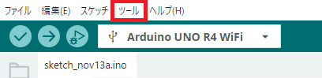
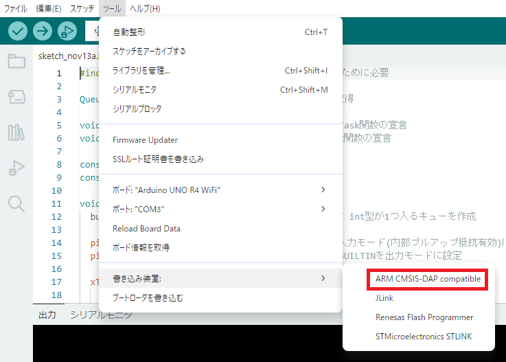
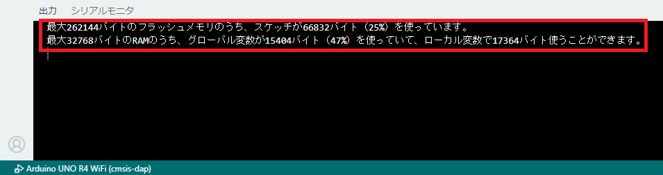
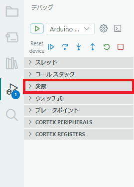
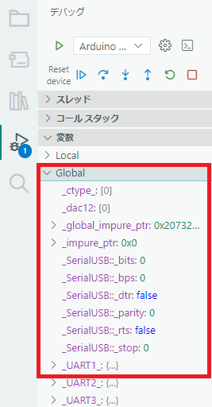

<!--
  手順書テンプレート(全ボード共通)
  - このファイルをコピーして、ボードごとのフォルダに保存してから書き始める。
  - 章の番号と名前は変えない。該当しない章は消さずに「本ボードでは作成しない(理由:〜)」と書く。
  - ボード独自の内容は、第9章以降に追加章として書く。
  - このコメントはプレビューには表示されない。消さずに残してよい。
-->

# 【Arduino UNO R4 WiFi】開発手順書

| 項目 | 内容 |
|---|---|
| 対象ボード | |
| 開発言語 | |
| IDE・ツール | (名称とバージョン) |
| SDK・ライブラリ | (名称とバージョン) |
| 開発PCのOS | (例:Windows 11 24H2) |
| 最終検証日 | (yyyy/mm/dd) |

## 改版履歴

| 版 | 日付 | 担当者 | 内容 |
|---|---|---|---|
| 0.1 | (yyyy/mm/dd) | | 新規作成 |

---

## 0. 概要

### 0.1 この手順書でできること
<!-- 読者がこの手順書を最後まで進めると何ができるようになるかを書く -->

### 0.2 必要な機材

| 品名 | 数量 | 備考 |
|---|---|---|
| | | |

### 0.3 前提知識・事前準備
<!-- 既存の Git/GitHub 運用・Redmine 運用を参考に、前提とする知識と準備を書く -->

---

## 1. 開発環境構築

### 1.1 ツールのインストール
### 1.2 ドライバのインストール
### 1.3 インストールできたことの確認

## 2. シリアルターミナルの使い方

### 2.1 使用するツールと接続方法
### 2.2 通信設定(ポート、ボーレートなど)
### 2.3 動作確認

## 3. プロジェクト作成

### 3.1 新規プロジェクトの作成
### 3.2 プロジェクトの構成(フォルダ・ファイルの役割)

## 4. コーディング・ビルド・書込み(RTOSなし)

<!-- 各題材の節は「作るもの → 配線 → プログラム → ビルドと書込み → 動作確認」の順で書く -->

### 4.1 題材1:LED点滅
### 4.2 題材2:ボタン入力
### 4.3 題材3:UART出力
### 4.4 題材4:タイマ割込み

## 5. コーディング・ビルド・書込み(FreeRTOS)

### 5.1 FreeRTOSの導入・設定
### 5.2 題材5:複数タスク
### 5.3 題材6:タスク間通信

## 6. デバッグ
この章では、デバッガを使ったデバッグとシリアル出力を使ったデバッグの両方の手順について記述する。<br>
### 6.1 デバッガの接続(配線図・写真)
Arduino IDE のデバッガを使用するため、追加でデバッガの接続は不要とする。
### 6.2 デバッグの開始
この節では、 Arduino IDE のデバッガを使ったデバッグの開始を行う。
1. Arduino IDE の画面上部の「スケッチ」タブを押下する。<br>
<br>

2. 「デバッグに最適化」を押下する。<br>
<br>

3. 画面上部の「ツール」タブを押下する。<br>
<br>

4. 「書き込み装置」を押下する。<br>
<br>

5. 「ARM CMSIS-DAP compatible」を押下する。<br>
<br>

6. 画面左上部の「検証」ボタンを押下する。<br>
<br>

7. 画面左上部の「書き込み」ボタンを押下する。<br>
<br>

8. 画面左上部の「デバッグの開始」ボタンを押下する。<br>
<br>

> 確認：画面左部のデバッグのアイコンに青丸の数字1がつき、デバッグが開始していることが確認できる<br>

### 6.3 ブレークポイント・ステップ実行
この節では、ブレークポイントの付与とステップ実行を行う。
1. 実行を止めたい行の行番号の左側を押下することで、ブレークポイントを付与する。<br>
<br>

2. 画面左上部の「デバッグの開始」ボタンを押下する。<br>
<br>

3. 画面左部の「デバッグ」タブからステップオーバーボタンを押下する。<br>
<br>

> 確認：ブレークポイントを付与した箇所で実行が止まり、手順3.で次の行が実行されることが確認できる<br>

### 6.4 変数・メモリ・レジスタの確認
この節では、デバッガによる変数・メモリ・レジスタの確認を行う。
1. 書き込みをした際に Arduino IDE の画面下部の「出力」タブに出力されるメモリ使用量を確認する。<br>
<br>

2. 実行を止めたい行の行番号の左側を押下することで、ブレークポイントを付与する。<br>
<br>

3. 画面左上部の「デバッグの開始」ボタンを押下する。<br>
<br>

4. 画面左側の「デバッグ」タブから「変数」タブを押下する。<br>
<br>

5. 「変数」タブ内の「Local」タブを押すことで、実行中の関数内のローカル変数を確認する。<br>
<br>

6. 「変数」タブ内の「Global」タブを押すことで、グローバル変数を確認する。<br>
<br>

7. 「変数」タブ内の「Static」タブを押すことで、Static変数を確認する。<br>
<br>

8. 「変数」タブ内の「Registers」タブを押すことで、レジスタを確認する。<br>
<br>

> 確認：変数・メモリ・レジスタを確認することができる<br>
> 注意：メモリを確認する際、出力タブが閉じている場合がある。その場合は再度書き込みを行うことで確認できる。

### 6.5 シリアル出力によるデバッグ
この節では、シリアル出力によるデバッグを行う。<br>
今回は「5.3 題材6」のコードをもとに、実行がどこまで進んでいるかをSrial.Println関数で確認する。
1. 題材6のコードを以下のように書き換える。
    ```c
    #include <Arduino_FreeRTOS.h>    // FreeRTOSを使うために必要

    QueueHandle_t blinkQueue;    // キューのハンドルを取得

    void ButtonTask(void *pvParameters);    // ButtonTask関数の宣言
    void LedTask(void *pvParameters);       // LedTask関数の宣言

    const int digitalInPin = D2;
    const int digitalOutPin = LED_BUILTIN;
    const int boud = 9600;

    void setup() {
      Serial.begin(boud);
      delay(1000);
      Serial.println("start setup");

      blinkQueue = xQueueCreate(1, sizeof(int));   // int型が1つ入るキューを作成

      pinMode(digitalInPin, INPUT_PULLUP);    // D2を入力モード(内部プルアップ抵抗有効)に設定
      pinMode(digitalOutPin, OUTPUT);         // LED_BUILTINを出力モードに設定

      xTaskCreate(      // タスクを作る
        ButtonTask,     // 関数名を指定
        "ButtonTask",   // タスクの名前
        128,            // タスクのスタックサイズ
        NULL,           // タスクに渡す引数
        2,              // タスクの優先度
        NULL            // 作成したハンドルの格納場所
      );

      Serial.println("create ButtonTask");

      xTaskCreate(      // タスクを作る
        LedTask,        // 関数名を指定
        "LedTask",      // タスクの名前
        128,            // タスクのスタックサイズ
        NULL,           // タスクに渡す引数
        1,              // タスクの優先度
        NULL            // 作成したハンドルの格納場所
      );

      Serial.println("create LedTask");

      vTaskStartScheduler();    // タスクを実行
    }

    void loop(){
      // 使用しない
    }

    void ButtonTask(void *pvParameters){    // ボタンの押下でLEDの点滅間隔を変更する関数
      Serial.println("start ButtonTask");

      int button_state = HIGH;
      int last_button_state = HIGH;
      int blink_mode = 0;

      while(1){
        button_state = digitalRead(digitalInPin);   // ボタンの状態を取得
        if(button_state == LOW){                    // ボタンが押されていたら
          if(last_button_state == HIGH){            // 前回のボタンの状態がHIGHだったら
            if(blink_mode == 0){                    // 点滅の間隔を切り替える
              blink_mode = 1;
              Serial.println("blink_mode 1");
            }else{
              blink_mode = 0;
              Serial.println("blink_mode 0");
            }
          }
        }

        xQueueSend(blinkQueue, &blink_mode, 0);    // 点滅間隔を送る
        last_button_state = button_state;           // 今回のボタンの状態を保持

        vTaskDelay(pdMS_TO_TICKS(10));              // タスクを待ち状態にする
      }
    }

    void LedTask(void *pvParameters){   // LEDを点滅させる関数
      Serial.println("start LedTask");

      int blink_mode = 0;
      int led_time = 500;
      int led_state = LOW;

      while(1){
        xQueueReceive(blinkQueue, &blink_mode, 0);   // 送られた点滅間隔を受け取る

        if (blink_mode == 0){     // 受け取った点滅間隔から待ち時間を定める
          led_time = 500;
        }else{
          led_time = 100;
        }

        if (led_state == HIGH){   // LEDの状態を切り替える
          led_state = LOW;
        }else{
          led_state = HIGH;
        }

        digitalWrite(digitalOutPin, led_state);   // LEDを点灯消灯させる
        vTaskDelay(pdMS_TO_TICKS(led_time));      // 定めた時間待機する
      }
    }
    ```
6. 画面左上部の「検証」ボタンを押下する。<br>
<br>

7. 画面左上部の「書き込み」ボタンを押下する。<br>
<br>

> 確認：シリアルモニタに「start setup」「create ButtonTask」「create LedTask」「start ButtonTask」「start LedTask」が表示され、その後ボタンを押すたびに「blink_mode」の値が1と0で切り替わることが確認できる

## 7. トラブルシューティング

| 症状 | 原因 | 対処 |
|---|---|---|
| | | |

## 8. 参考資料

- 

<!-- ボード独自の追加章がある場合は、ここから「## 9. 〜」として追加する -->

<!--
  記述ルール(書きぶりを全章でそろえる)
  1. 見出し:章は「## 1. 開発環境構築」、節は「### 1.1 ツールのインストール」の形にする。
  2. 手順:番号付きリストで書き、1つの番号に1つの操作。文末は「〜する。」にそろえる。
  3. 確認:手順のあとに「> 確認:〜れば成功」と、成功したかどうかの判断方法を書く。
  4. 注意:まちがえやすい所は「> 注意:〜」と書く。
  5. 画像:画面操作にはスクリーンショットを付ける。images/ に置き、名前は担当番号から始める(例:p1_ext.png)。
  6. 図:処理の流れやタスクの関係は Mermaid で書く。配線は図か写真で、ピン番号と信号名を書く。
  7. プログラム:手順書の中にコードブロックで書き、日本語のコメントを付ける。
  8. バージョン:ツールと SDK のバージョンを書く。
  9. 用語:同じものは同じことばで書く。英数字は半角で、日本語との間に半角スペースを入れる。
  10. つまずいた点:第7章に必ず記録する。
-->
