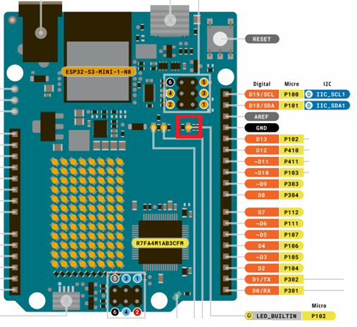
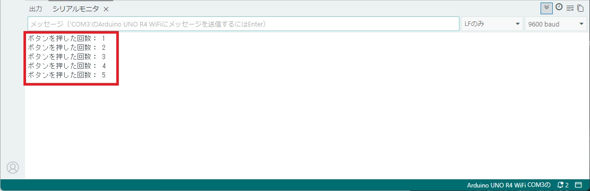

<!--
  手順書テンプレート(全ボード共通)
  - このファイルをコピーして、ボードごとのフォルダに保存してから書き始める。
  - 章の番号と名前は変えない。該当しない章は消さずに「本ボードでは作成しない(理由:〜)」と書く。
  - ボード独自の内容は、第9章以降に追加章として書く。
  - このコメントはプレビューには表示されない。消さずに残してよい。
-->

# 【Arduino UNO R4 WiFi】開発手順書

| 項目 | 内容 |
|---|---|
| 対象ボード | |
| 開発言語 | |
| IDE・ツール | (名称とバージョン) |
| SDK・ライブラリ | (名称とバージョン) |
| 開発PCのOS | (例:Windows 11 24H2) |
| 最終検証日 | (yyyy/mm/dd) |

## 改版履歴

| 版 | 日付 | 担当者 | 内容 |
|---|---|---|---|
| 0.1 | (yyyy/mm/dd) | | 新規作成 |

---

## 0. 概要

### 0.1 この手順書でできること
<!-- 読者がこの手順書を最後まで進めると何ができるようになるかを書く -->

### 0.2 必要な機材

| 品名 | 数量 | 備考 |
|---|---|---|
| | | |

### 0.3 前提知識・事前準備
<!-- 既存の Git/GitHub 運用・Redmine 運用を参考に、前提とする知識と準備を書く -->

---

## 1. 開発環境構築

### 1.1 ツールのインストール
### 1.2 ドライバのインストール
### 1.3 インストールできたことの確認

## 2. シリアルターミナルの使い方

### 2.1 使用するツールと接続方法
### 2.2 通信設定(ポート、ボーレートなど)
### 2.3 動作確認

## 3. プロジェクト作成

### 3.1 新規プロジェクトの作成
### 3.2 プロジェクトの構成(フォルダ・ファイルの役割)

## 4. コーディング・ビルド・書込み(RTOSなし)

<!-- 各題材の節は「作るもの → 配線 → プログラム → ビルドと書込み → 動作確認」の順で書く -->

### 4.1 題材1:LED点滅
### 4.2 題材2:ボタン入力
### 4.3 題材3:UART出力
### 4.4 題材4:タイマ割込み

## 5. コーディング・ビルド・書込み(FreeRTOS)
本章では FreeRTOS の導入方法、および FreeRTOS を用いた題材について記述する。<br>

### 5.1 FreeRTOSの導入・設定
本節では FreeRTOS の導入・設定を行う。
1. Arduino UNO R4 Boards のボードパッケージには FreeRTOS がすでに入っているため、追加でインストールは不要とする。<br>

### 5.2 題材5:複数タスク
本節では複数タスクのプログラムを実装する。<br>
- **作るもの**<br>
LED を 0.5 秒ごと点滅させながらボタンを押した回数をカウントするプログラム。<br>
- **配線**<br>
  1. ボードの D2 と GND (画像の赤枠部分)にジャンパワイヤを配線してボタンを接続する。<br>
  <br>

- **プログラム**<br>
  1. 開発 PC の USB ポートに Arduino UNO R4 WiFi を接続する。<br>

  1. Arduino IDE を起動する。<br>

  1. スケッチを **プログラム** のコードに書き換える。<br>

    ```c
    #include <Arduino_FreeRTOS.h>    // FreeRTOSを使うために必要

    void LedTask(void *pvParameters);       // LedTask関数の宣言
    void ButtonTask(void *pvParameters);    // ButtonTask関数の宣言

    const int digitalInPin = D2;
    const int digitalOutPin = LED_BUILTIN;
    bool btnPush = false;
    int count = 0;

    void setup() {
      Serial.begin(9600);                  // シリアル通信速度を9600bpsに設定
      pinMode(digitalInPin, INPUT_PULLUP); // D2を入力モード(内部プルアップ抵抗有効)に設定
      pinMode(digitalOutPin, OUTPUT);      // LED_BUILTINを出力モードに設定

      xTaskCreate(    // タスクを作る
        LedTask,      // 関数名を指定
        "LedTask",    // タスクの名前
        128,          // タスクのスタックサイズ
        NULL,         // タスクに渡す引数
        2,            // タスクの優先度
        NULL          // 作成したハンドルの格納場所
      );

      xTaskCreate(      // タスクを作る
        ButtonTask,     // 関数名を指定
        "ButtonTask",   // タスクの名前
        128,            // タスクのスタックサイズ
        NULL,           // タスクに渡す引数
        1,              // タスクの優先度
        NULL            // 作成したハンドルの格納場所
      );

      vTaskStartScheduler();    // タスクを実行
    }

    void loop(){
      // 使用しない
    }

    void LedTask(void *pvParameters) {
      while(1){
        digitalWrite(digitalOutPin, HIGH); // LEDを点灯(HIGHは電圧を5Vにする)   
        delay(500);                        // 0.5秒間(500ms)待つ
        digitalWrite(digitalOutPin, LOW);  // LEDを消灯(LOWは電圧を0vにする)
        delay(500);                        // 0.5秒間(500ms)待つ
      }
    }

    void ButtonTask(void *pvParameters) {
      while(1){
        if(digitalRead(digitalInPin) == LOW) {      // ボタンが押されている
        btnPush = true;                             // ボタン押下フラグをtrue
      }else {                                       // ボタンが押されていない
          if (btnPush) {                            // ボタンを押してから離した
            count++;                                // ボタンを押した回数をカウントアップ
            Serial.print("ボタンを押した回数： ");    // "ボタンを押した回数： "という文字列をシリアル出力する
            Serial.println(count, DEC);             // ボタンが押した回数を10進数シリアル出力する
            btnPush = false;                        // ボタン押下フラグをfalse
          }
        }
        delay(50);  // 0.05秒間(50ms)待つ
      }
    }
    ```
- **ビルドと書込み**<br>
  1. 「検証」 を押下する。<br>
  <br>
      > 確認: Arduino IDE の右下に「コンパイル完了」と表示されれば検証が成功したことが確認できる。<br>

  1. 「書き込み」 を押下する。<br>
  <br>
      > 確認: Arduino IDE の右下に「書き込み完了」と表示されれば書き込みが成功したことが確認できる。<br>
- **動作確認**<br>
  1. Arduino UNO R4 WiFi の LED (画像の赤枠)を確認する。<br>
  <br>
  1. シリアルモニタを確認する。<br>
  <br>
  1. ボードに接続したボタンを押す。<br>
      > 確認: LED が 0.5 秒ごとに点滅しながら、ボタンを押した回数がシリアルモニタに表示されることが確認できる。<br>

### 5.3 題材6:タスク間通信
本説ではタスク間通信のプログラムを実装する。<br>
- **作るもの**<br>
0.5 秒間隔で点滅している LED を、ボタンを押すことで 0.1 秒間隔の点滅に切り替えるプログラム。<br>
- **配線**<br>
  1. ボードの D2 と GND (画像の赤枠部分)にジャンパワイヤを配線してボタンを接続する。<br>
  <br>

- **プログラム**<br>
  1. 開発 PC の USB ポートに Arduino UNO R4 WiFi を接続する。<br>

  1. Arduino IDE を起動する。<br>

  1. スケッチを **プログラム** のコードに書き換える。<br>

    ```c
    #include <Arduino_FreeRTOS.h>    // FreeRTOSを使うために必要

    QueueHandle_t blinkQueue;    // キューのハンドルを取得

    void ButtonTask(void *pvParameters);    // ButtonTask関数の宣言
    void LedTask(void *pvParameters);       // LedTask関数の宣言

    const int digitalInPin = D2;
    const int digitalOutPin = LED_BUILTIN;

    void setup() {
      blinkQueue = xQueueCreate(1, sizeof(int));   // int型が1つ入るキューを作成
  
      pinMode(digitalInPin, INPUT_PULLUP);    // D2を入力モード(内部プルアップ抵抗有効)に設定
      pinMode(digitalOutPin, OUTPUT);         // LED_BUILTINを出力モードに設定

      xTaskCreate(      // タスクを作る
        ButtonTask,     // 関数名を指定
        "ButtonTask",   // タスクの名前
        128,            // タスクのスタックサイズ
        NULL,           // タスクに渡す引数
        2,              // タスクの優先度
        NULL            // 作成したハンドルの格納場所
      );

      xTaskCreate(      // タスクを作る
        LedTask,        // 関数名を指定
        "LedTask",      // タスクの名前
        128,            // タスクのスタックサイズ
        NULL,           // タスクに渡す引数
        1,              // タスクの優先度
        NULL            // 作成したハンドルの格納場所
      );  

      vTaskStartScheduler();    // タスクを実行
    }

    void loop(){
      // 使用しない
    }

    void ButtonTask(void *pvParameters){    // ボタンの押下でLEDの点滅間隔を変更する関数
      int button_state = HIGH;
      int last_button_state = HIGH;
      int blink_mode = 0;

      while(1){
        button_state = digitalRead(digitalInPin);   // ボタンの状態を取得
        if(button_state == LOW){                    // ボタンが押されていたら
          if(last_button_state == HIGH){            // 前回のボタンの状態がHIGHだったら
            if(blink_mode == 0){                    // 点滅の間隔を切り替える
              blink_mode = 1;
            }else{
              blink_mode = 0;
            }
          }
        }

        xQueueSend(blinkQueue, &blink_mode, 0);    // 点滅間隔を送る
        last_button_state = button_state;           // 今回のボタンの状態を保持

        vTaskDelay(pdMS_TO_TICKS(10));              // タスクを待ち状態にする
      }
    }

    void LedTask(void *pvParameters){   // LEDを点滅させる関数
      int blink_mode = 0;
      int led_time = 500;
      int led_state = LOW;

      while(1){
        xQueueReceive(blinkQueue, &blink_mode, 0);   // 送られた点滅間隔を受け取る
    
        if (blink_mode == 0){     // 受け取った点滅間隔から待ち時間を定める
          led_time = 500;
        }else{
          led_time = 100;
        }

        if (led_state == HIGH){   // LEDの状態を切り替える
          led_state = LOW;
        }else{
          led_state = HIGH;
        }

        digitalWrite(digitalOutPin, led_state);   // LEDを点灯消灯させる
        vTaskDelay(pdMS_TO_TICKS(led_time));      // 定めた時間待機する
      }
    }
    ```
- **ビルドと書込み**<br>
  1. 「検証」 を押下する。<br>
  <br>
      > 確認: Arduino IDE の右下に「コンパイル完了」と表示されれば検証が成功したことが確認できる。<br>

  1. 「書き込み」 を押下する。<br>
  <br>
      > 確認: Arduino IDE の右下に「書き込み完了」と表示されれば書き込みが成功したことが確認できる。<br>

- **動作確認**<br>
  1. Arduino UNO R4 WiFi の LED (画像の赤枠)を確認する。<br>
  <br>

  1. ボードに接続したボタンを押す。<br>
      > 確認: LED の点滅間隔が 0.5 秒から 0.1 秒に切り替わることが確認できる。<br>

## 6. デバッグ

### 6.1 デバッガの接続(配線図・写真)
### 6.2 デバッグの開始
### 6.3 ブレークポイント・ステップ実行
### 6.4 変数・メモリ・レジスタの確認

## 7. トラブルシューティング

| 症状 | 原因 | 対処 |
|---|---|---|
| | | |

## 8. 参考資料

- 

<!-- ボード独自の追加章がある場合は、ここから「## 9. 〜」として追加する -->

<!--
  記述ルール(書きぶりを全章でそろえる)
  1. 見出し:章は「## 1. 開発環境構築」、節は「### 1.1 ツールのインストール」の形にする。
  2. 手順:番号付きリストで書き、1つの番号に1つの操作。文末は「〜する。」にそろえる。
  3. 確認:手順のあとに「> 確認:〜れば成功」と、成功したかどうかの判断方法を書く。
  4. 注意:まちがえやすい所は「> 注意:〜」と書く。
  5. 画像:画面操作にはスクリーンショットを付ける。images/ に置き、名前は担当番号から始める(例:p1_ext.png)。
  6. 図:処理の流れやタスクの関係は Mermaid で書く。配線は図か写真で、ピン番号と信号名を書く。
  7. プログラム:手順書の中にコードブロックで書き、日本語のコメントを付ける。
  8. バージョン:ツールと SDK のバージョンを書く。
  9. 用語:同じものは同じことばで書く。英数字は半角で、日本語との間に半角スペースを入れる。
  10. つまずいた点:第7章に必ず記録する。
-->
