<!--
  手順書テンプレート(全ボード共通)
  - このファイルをコピーして、ボードごとのフォルダに保存してから書き始める。
  - 章の番号と名前は変えない。該当しない章は消さずに「本ボードでは作成しない(理由:〜)」と書く。
  - ボード独自の内容は、第9章以降に追加章として書く。
  - このコメントはプレビューには表示されない。消さずに残してよい。
-->

# 【Arduino UNO R4 WiFi】開発手順書

| 項目 | 内容 |
|---|---|
| 対象ボード | Arduino UNO R4 WiFi |
| 開発言語 | C++ |
| IDE・ツール | Arduino IDE 2.3.11 |
| SDK・ライブラリ | Arduino UNO R4 Boards 1.6.0 |
| 開発PCのOS | Windows 11 Pro 25H2 |
| 最終検証日 | 2026/11/27 |

## 改版履歴

| 版 | 日付 | 担当者 | 内容 |
|---|---|---|---|
| 0.1 | 2026/11/25 | 吉田 | 新規作成 |
| 0.2 | 2026/11/27 | 吉田 | 第0章の記述を修正 |
|  |  | 吉田 | 第1章の記述を修正 |
|  |  | 吉田 | 第2章の記述を修正 |
|  |  | 吉田 | 第3章の記述を修正 |
|  |  | 吉田 | 第4章の記述を修正 |
|  |  | 中西 | 第5章の記述を修正 |
|  |  | 中西 | 第6章の記述を修正 |

---

## 0. 概要
この章では、この手順書でできること、手順書を進めるうえで必要な機材・前提知識について記述する。

### 0.1 この手順書でできること
<!-- 読者がこの手順書を最後まで進めると何ができるようになるかを書く -->
この手順書は、 Arduino UNO R4 WiFi を使ったマイコンボードプログラミングの開発環境の構築手順、題材を用いたプログラムの書き込み手順について記述する。<br>
手順書を最後まで進めることで、 Arduino UNO R4 WiFi のマイコンボードプログラミングができるようになる。<br>

### 0.2 必要な機材
この節では、手順書を進めるうえで必要な機材について記述する。

| 品名 | 数量 | 備考 |
|---|---|---|
| Arduino UNO R4 WiFi | 1人1台 | 開発するボード |
| USB ケーブル( Type-C 、データ通信対応) | 1人1本 | 給電・書き込み・デバッグで使用する |
| タクトスイッチ | 1人1個 | 題材2・3・5・6で使用する |
| ジャンパワイヤ(オス・メス) | 1人2本 | タクトスイッチの配線 |

### 0.3 前提知識・事前準備
<!-- 既存の Git/GitHub 運用・Redmine 運用を参考に、前提とする知識と準備を書く -->
この節では、手順書を進めるうえで必要な前提知識・事前準備について記述する。

- **前提知識**<br>
C++ の基礎知識を有していること。<br>
また、 Arduino のマイコンボードプログラミングの用語の意味を理解していること。<br>

    | 用語 | 説明 |
    | --- | --- |
    | スケッチ | Arduino のプログラム(.ino ファイル)のことを指す。<br>手順書の章・節の名前では **プロジェクト** と記述している。 |
    | 検証 | コードをマイコン用のプログラムに変換することを指す。<br>手順書の章・節の名前では **ビルド** と記述している。 |
    | 書き込み | 変換したプログラムをボードへ書き込むことを指す。 |
    | シリアルモニタ | ボードと PC 間で送受信される情報を確認するためのツールを指す。 <br>手順書の章・節の名前では **シリアルターミナル** と記述している。 |
    | ボードマネージャ | ボードパッケージを入れるための Arduino IDE の機能のことを指す。 |
    | ボードパッケージ | Arduino IDE 上でボードを動かすためのデバイスドライバやライブラリのことを指す。 |

- **事前準備**<br>
[必要な機材](#02-必要な機材)に記述されている機材を準備すること。<br>

---

## 1. 開発環境構築
この章では、開発環境の構築手順について記述する。

### 1.1 ツールのインストール
この節では、Arduino IDE のインストール手順を記述する。<br>

1. Arduino IDE のダウンロードページ (https://www.arduino.cc/en/software/) へアクセスする。<br>

1. 「Windows Win 10 or newer (64-bit)」 を選択する。<br>
    <br>

1. 「DOWNLOAD」 を押下する。<br>
    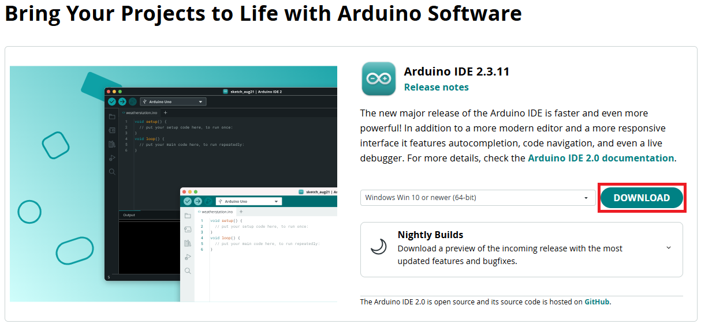<br>

1. ダウンロードしたインストーラを実行する。<br>
    <br>

1. ライセンス条項を確認し、 「同意する」 を押下する。<br>
    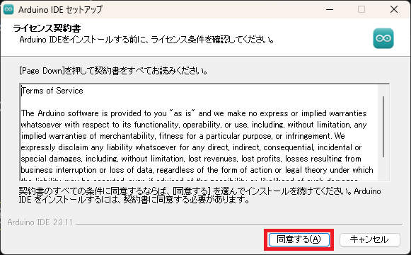<br>

1. インストールオプションの選択は変更せず、 「次へ」 を押下する。<br>
    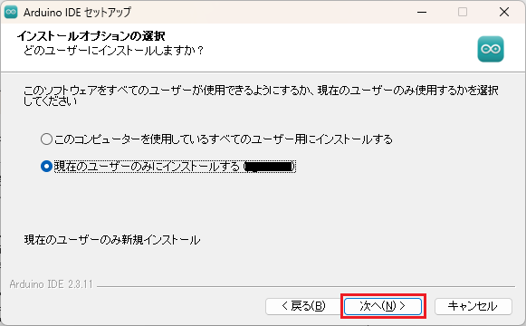<br>

1. インストール先フォルダは変更せず、 「インストール」 を押下する。<br>
    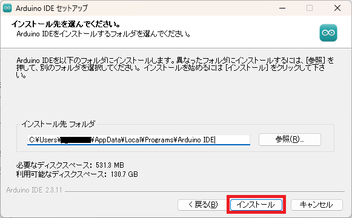<br>

1. 「完了」 を押下する。<br>
    <br>
    > 確認:画像の画面が表示されれば、Arduino IDE のインストールが完了したことが確認できる。<br>

### 1.2 ドライバのインストール
この節では、デバイスドライバのインストール手順を記述する。<br>

1. Arduino IDE を起動する。<br>

1. アクセス許可の確認画面が表示された場合、「許可」 を押下してアクセスを許可する。<br>
    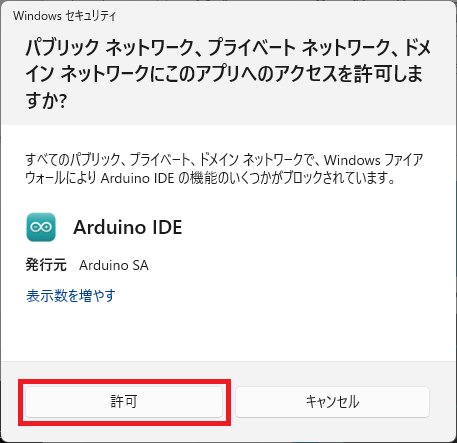<br>

1. Adafruit Industries LLC ポート (発行元: Adafruit Industries ) のインストール確認画面が表示された場合、「インストール」 を押下してインストールする。<br>
    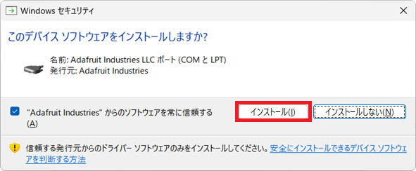<br>

1. Arduino USB Driver (発行元: Arduino srl ) のインストール確認画面が表示された場合、「インストール」 を押下してインストールする。<br>
    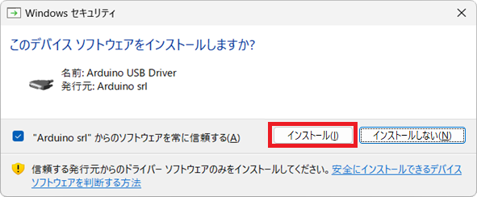<br>

1. Arduino USB Driver (発行元: Arduino SA ) のインストール確認画面が表示された場合、「インストール」 を押下してインストールする。<br>
    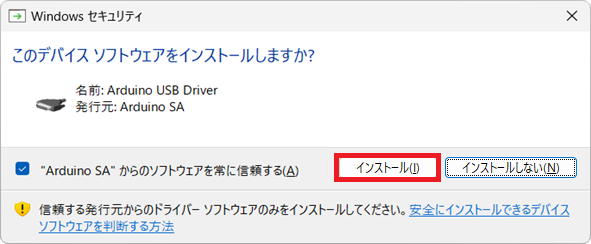<br>

1. Genuino USB Driver (発行元: Arduino LLC ) のインストール確認画面が表示された場合、「インストール」 を押下してインストールする。<br>
    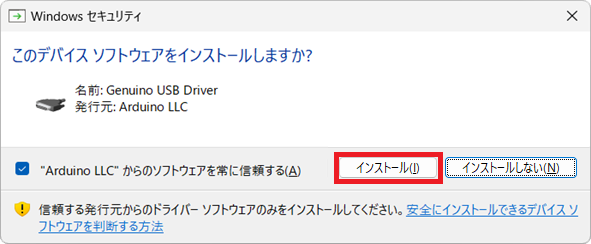<br>

1. 「 File 」 を押下する。<br>
    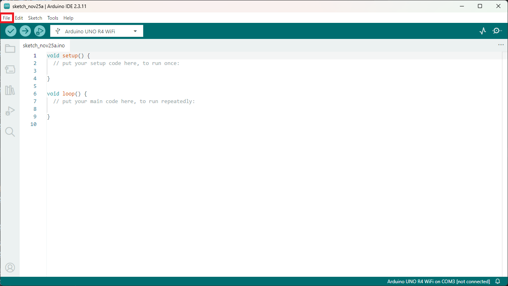<br>

1. 「 Preferences... 」 を押下する。<br>
    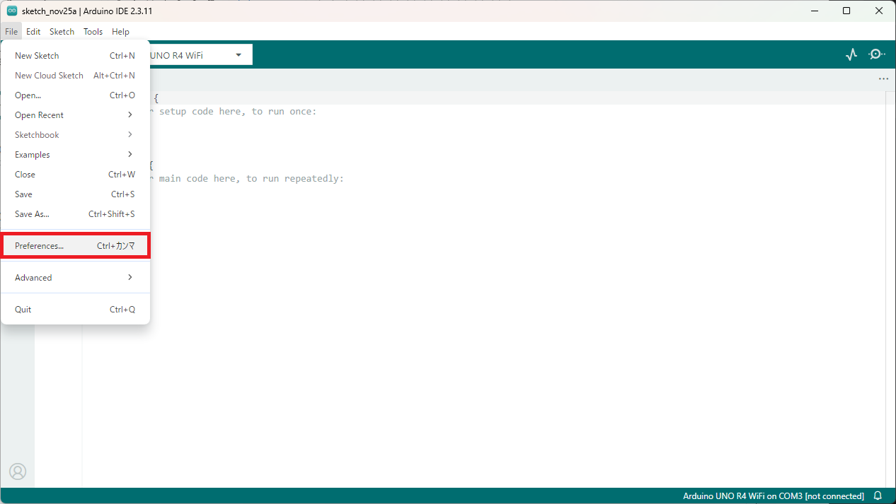<br>

1. 「 Language 」 を日本語に変更する。<br>
    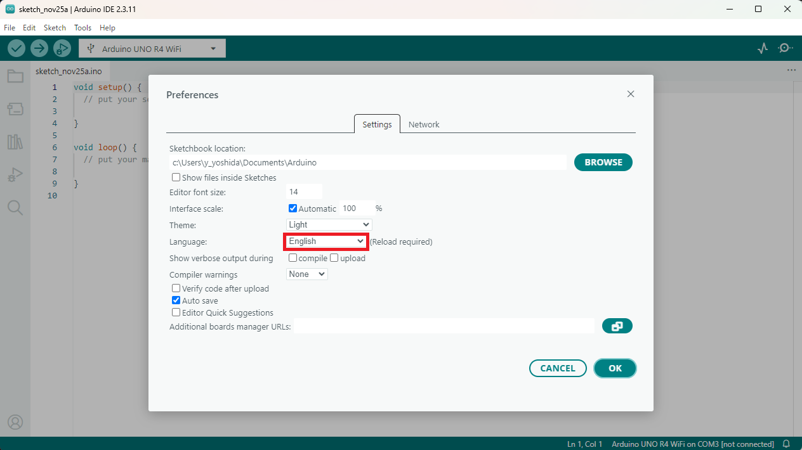<br>

1. 「 Editor Quick Suggestions 」 をチェックする。<br>
    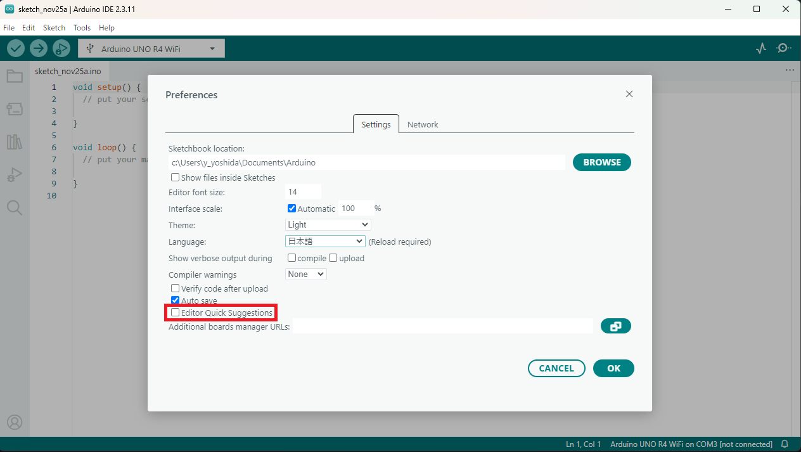<br>

1. 「 OK 」 を押下する。<br>
    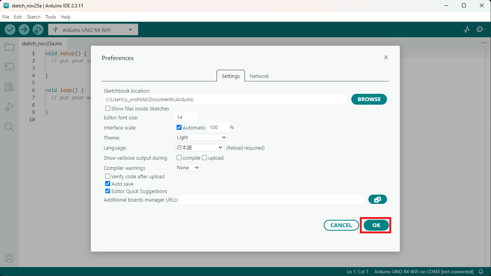<br>
    > 確認:Arduino IDE のメニューが日本語で表示されれば、Arduino IDE の初期設定が完了したことが確認できる。<br>

1. ボードのアイコンを押下する。<br>
    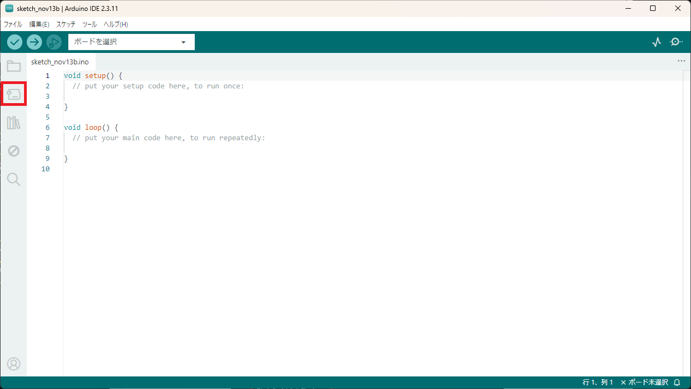<br>

1. 「検索をフィルタ…」 の入力欄に **Arduino UNO R4 Boards** と入力する。<br>
    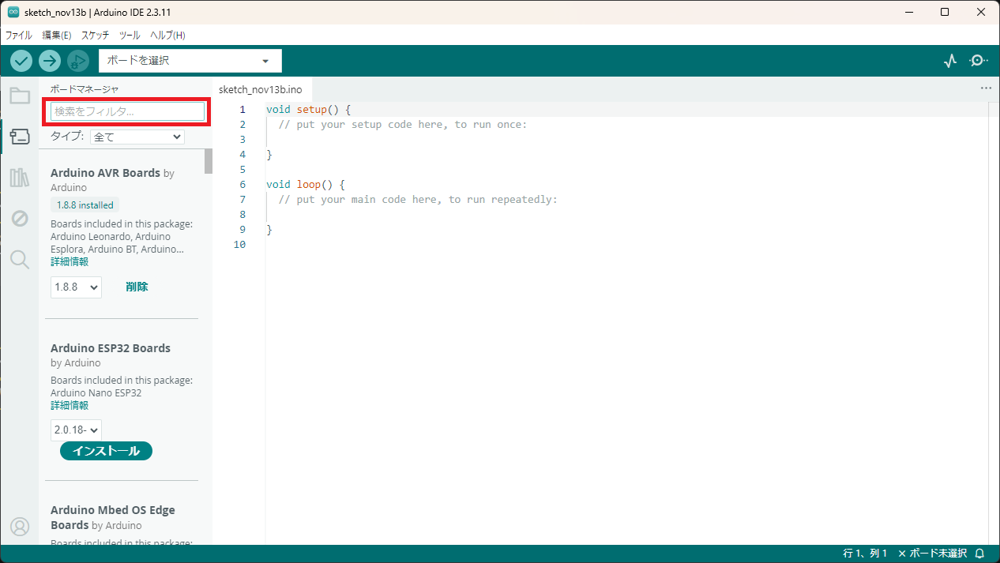<br>

1. フィルタで表示された 「Arduino UNO R4 Boards」 の下にある 「インストール」 を押下する。<br>
    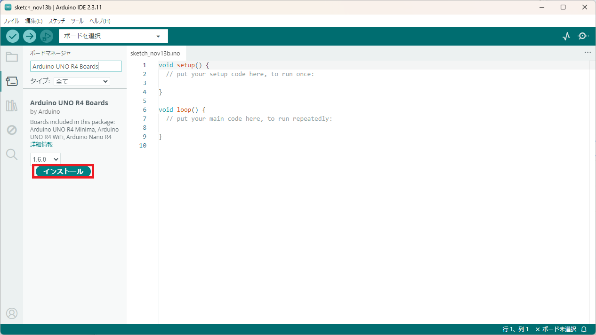<br>

1. Arduino ユニバーサル シリアル バス デバイス (発行元: Arduino SA ) のインストール確認画面が表示された場合、「インストール」 を押下してインストールする。<br>
    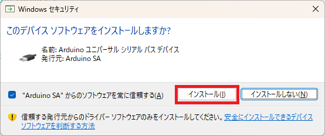<br>
    > 確認:Arduino IDE の出力に 「Platform arduino:renesas_uno@1.6.0 installed」 と表示されれば、デバイスドライバのインストールが完了したことが確認できる。<br>

### 1.3 インストールできたことの確認
この節では、ツールとデバイスドライバがインストールできたことの確認をする。<br>

1. コントロールパネルを開く。<br>
    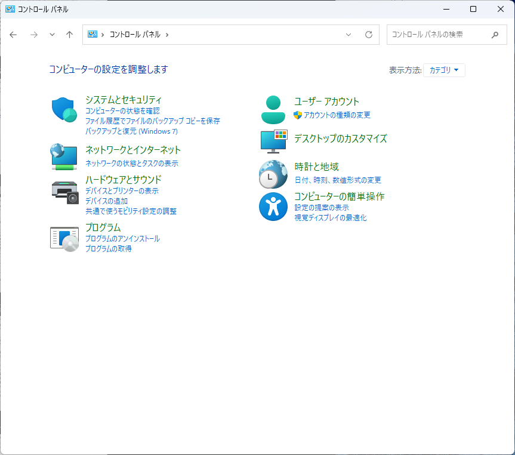<br>

1. 「プログラム」 を押下する。<br>
    <br>

1. 「プログラムと機能」 を押下する。<br>
    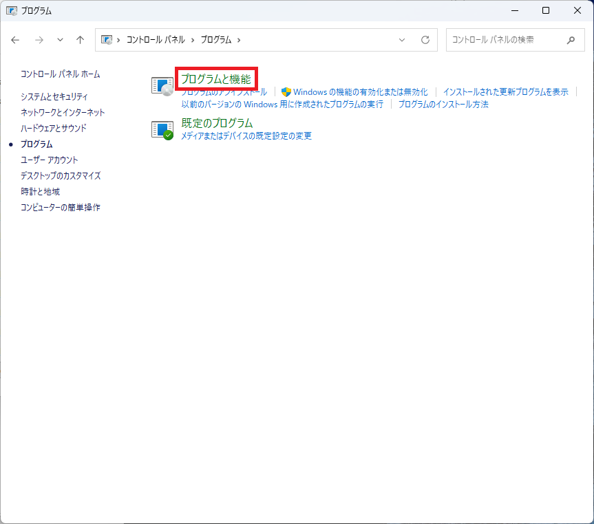<br>

1. 一覧から「Arduino IDE」 を探す。<br>
    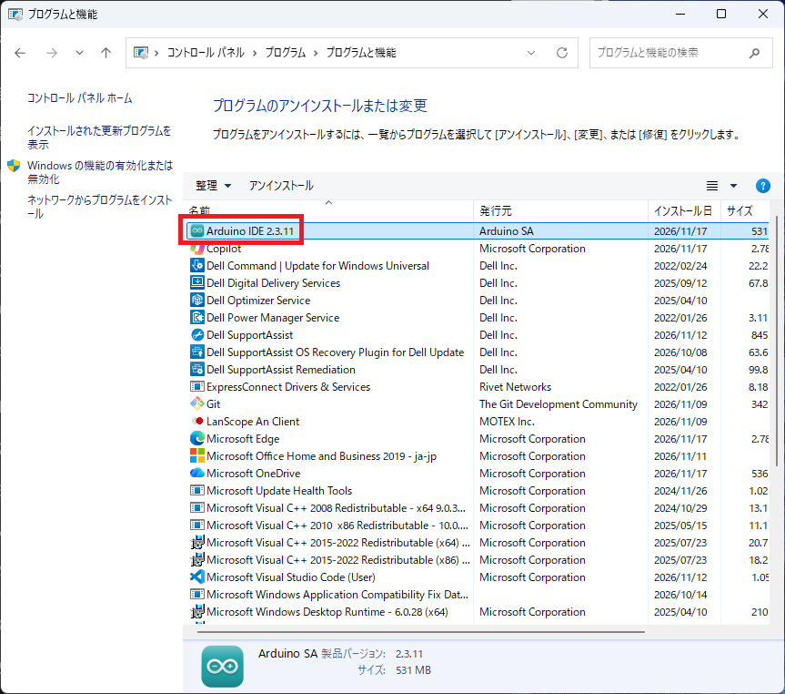<br>
    > 確認:一覧に「Arduino IDE」があれば、Arduino IDE のインストールが成功したことが確認できる。<br>

1. 開発 PC の USB ポートに Arduino UNO R4 WiFi を接続する。<br>

1. Arduino IDE を起動する。<br>
    <br>

1. 「ツール」 を押下する。<br>
    <br>

1. 「ボード情報を取得」 を押下する。<br>
    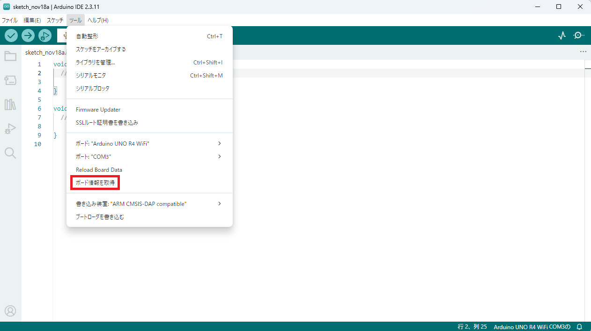<br>

1. ボード情報を確認する。<br>
    <br>
    > 確認:「Arduino UNO R4 WiFi」 のボード情報が表示できていれば、デバイスドライバのインストールが成功したことが確認できる。<br>

## 2. シリアルターミナルの使い方
この章では、シリアルモニタの使い方について記述する。

### 2.1 使用するツールと接続方法
この節では、シリアルモニタとして使用するツール、接続方法を記述する。

| ツール | 接続方法 |
|---|---|
| Arduino IDE | 接続なし(ツール上のシリアルモニタを使用) |

### 2.2 通信設定(ポート、ボーレートなど)
この節では、シリアルモニタの通信設定を記述する。

| ポート | ボーレート |
|---|---|
| ボードを接続したCOM | ボードに設定したシリアル通信速度 |

### 2.3 動作確認
この節では、シリアルモニタの動作確認手順を記述する。

1. 開発 PC の USB ポートに Arduino UNO R4 WiFi を接続する。<br>

1. Arduino IDE を起動する。<br>

1. スケッチを次のコードに書き換える。<br>
    ```c
    void setup() {
      Serial.begin(9600); // シリアル通信速度を9600bpsに設定
    }

    void loop() {
      Serial.print("test\r\n"); // "test"という文字列をシリアル出力する
      delay(1000);              // 1秒間(1000ms)待つ
    }
    ```
    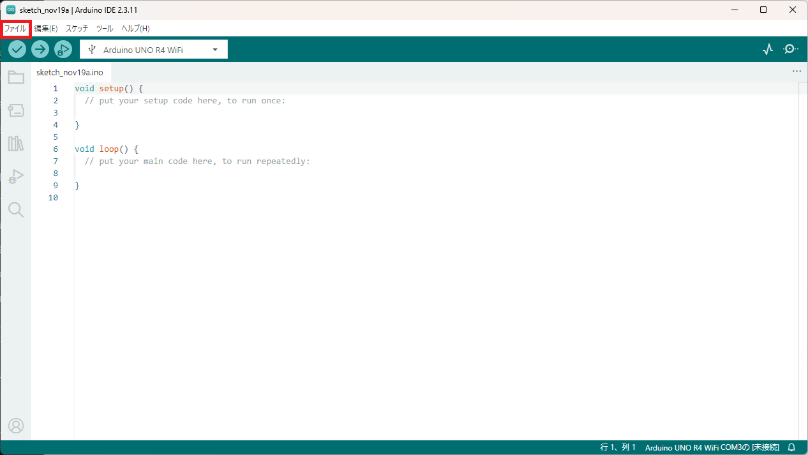<br>

1. 「検証」 を押下する。<br>
    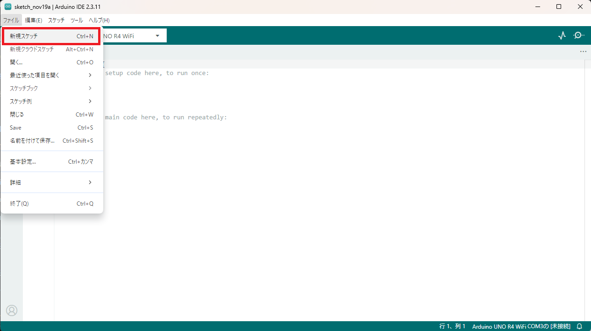<br>
    > 確認: Arduino IDE の右下に「コンパイル完了」と表示されれば検証が成功したことが確認できる。<br>

1. 「書き込み」 を押下する。<br>
    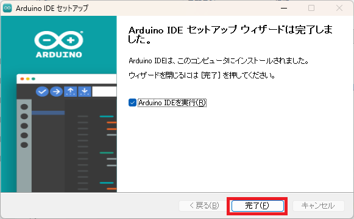<br>
    > 確認: Arduino IDE の右下に「書き込み完了」と表示されれば書き込みが成功したことが確認できる。<br>

1. シリアルモニタのアイコンを押下する。<br>
    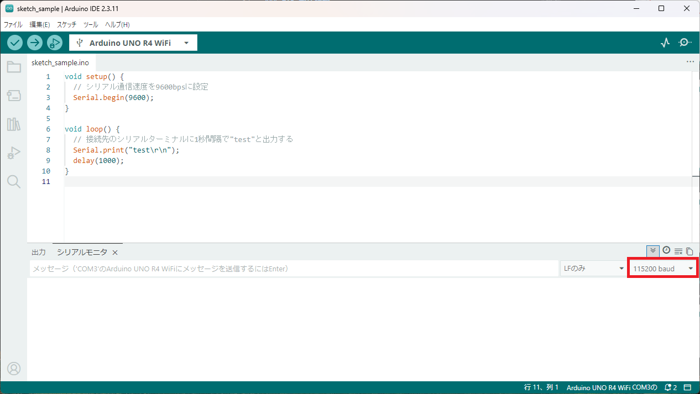<br>

1. シリアルモニタのシリアル通信速度を **9600baud** に変更する。<br>
    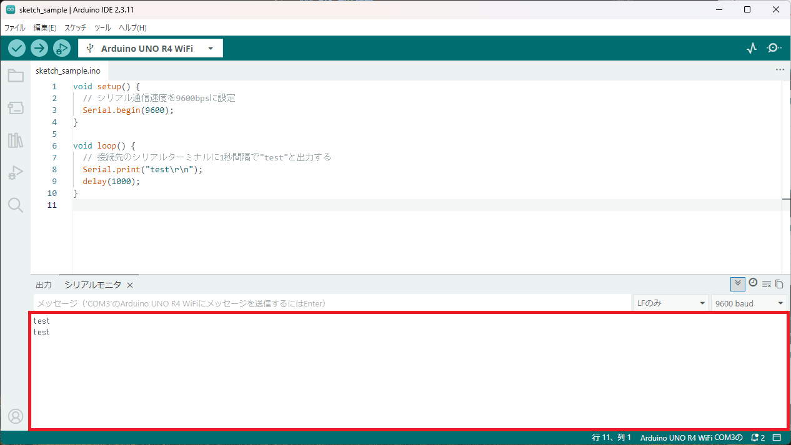<br>

1. シリアルモニタの出力を確認する。<br>
    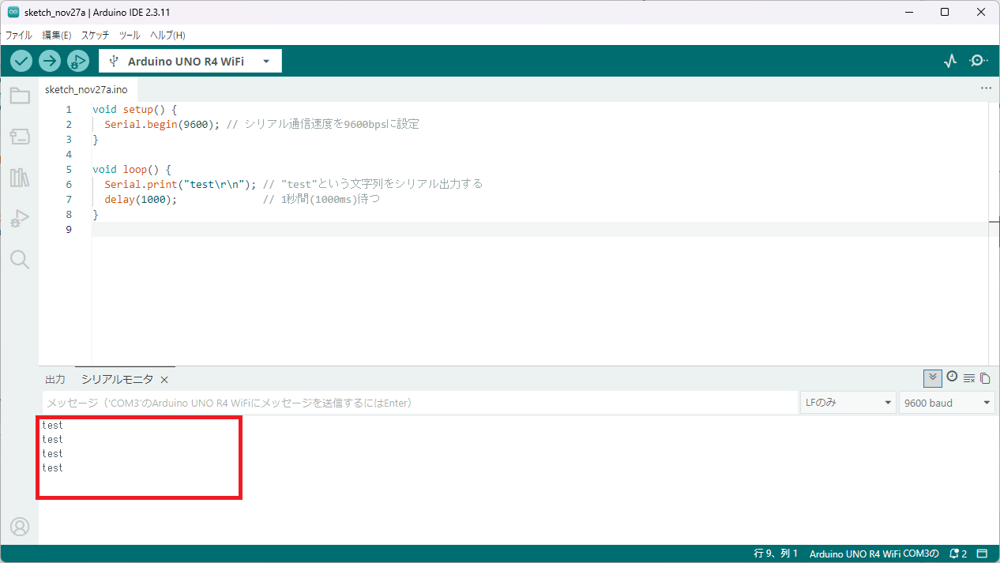<br>
    > 確認: 1秒ごとに **test** と出力されればシリアルモニタの動作が期待通りであることが確認できる。<br>

## 3. プロジェクト作成
この章では、スケッチの作成手順、フォルダ・ファイル構成、主要な関数の役割について記述する。

### 3.1 新規プロジェクトの作成
この節では、スケッチの作成手順を記述する。

1. Arduino IDE を起動する。<br>

1. 「ファイル」 を押下する。<br>
    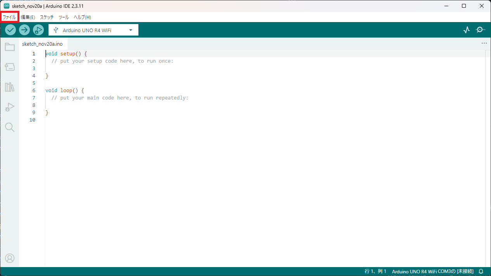<br>

1. 「名前を付けて保存...」 を押下する。<br>
    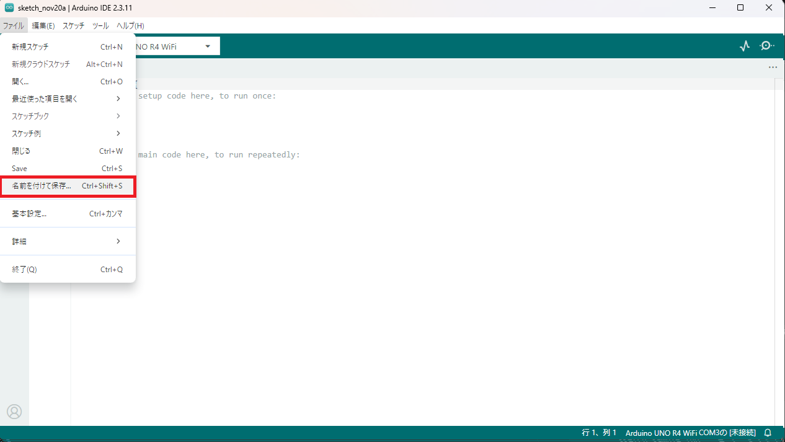<br>

1. 「スケッチフォルダ名」 を入力する。<br>
    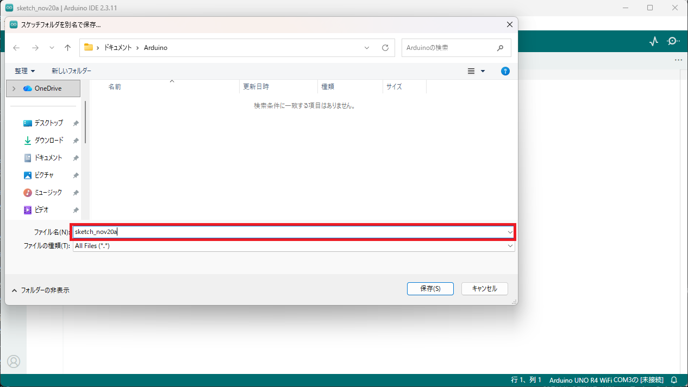<br>

1. 「保存」 を押下する。<br>
    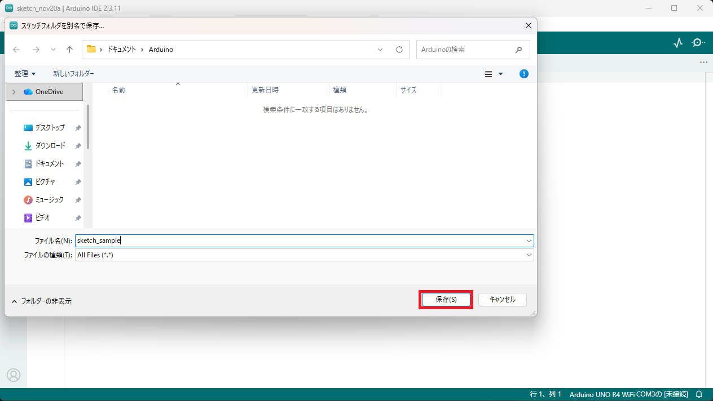<br>
    > 確認:保存先フォルダにスケッチフォルダ名と同名のフォルダと .ino ファイルがあれば、スケッチの作成が成功したことが確認できる。<br>

### 3.2 プロジェクトの構成(フォルダ・ファイルの役割)
この節では、スケッチを作成した際に生成されるフォルダ・ファイル構成を記述する。

例) **sketch_sample** という名前でスケッチを作成した場合
```
保存先フォルダ
  └─sketch_sample            ← スケッチフォルダ
      └─sketch_sample.ino    ← ソースファイル
```

### 3.3 setup() と loop() の役割
この節では、スケッチの主要な関数である setup() と loop() の役割を記述する。

| 関数名 | 役割 |
|---|---|
| setup() | Arduino の初期化処理。入出力ピンの設定、シリアル通信の初期化など。 |
| loop() | Arduino に実行させたい繰り返し処理。LEDの点灯・消灯、シリアルの入力・出力など。 |

## 4. コーディング・ビルド・書込み(RTOSなし)
この章では、RTOS を使用しない題材について記述する。
<!-- 各題材の節は「作るもの → 配線 → プログラム → ビルドと書込み → 動作確認」の順で書く -->

### 4.1 題材1:LED点滅
この節では、 LED 点滅のプログラムを実装する。

- **作るもの**<br>
LED を0.5秒ごと点滅させるプログラム。<br>
- **配線**<br>
この節の題材では配線不要。<br>
- **プログラム**<br>
  1. 開発 PC の USB ポートに Arduino UNO R4 WiFi を接続する。<br>

  1. Arduino IDE を起動する。<br>

  1. スケッチを次のコードに書き換える。<br>
      ```c
      const int digitalOutPin = LED_BUILTIN;

      void setup() {
        pinMode(digitalOutPin, OUTPUT); // LED_BUILTINを出力モードに設定
      }

      void loop() {
        digitalWrite(digitalOutPin, HIGH); // LEDを点灯(HIGHは電圧を5Vにする)   
        delay(500);                        // 0.5秒間(500ms)待つ
        digitalWrite(digitalOutPin, LOW);  // LEDを消灯(LOWは電圧を0Vにする)
        delay(500);                        // 0.5秒間(500ms)待つ
      }
      ```

- **ビルドと書込み**<br>
  1. 「検証」 を押下する。<br>
      <br>
      > 確認: Arduino IDE の右下に「コンパイル完了」と表示されれば検証が成功したことが確認できる。<br>

  1. 「書き込み」 を押下する。<br>
      <br>
      > 確認: Arduino IDE の右下に「書き込み完了」と表示されれば書き込みが成功したことが確認できる。<br>

- **動作確認**<br>
  1. Arduino UNO R4 WiFi の LED (画像の赤枠)を確認する。<br>
      <br>
      > 確認: LED が0.5秒ごとに点滅していれば動作が期待通りであることが確認できる。<br>

### 4.2 題材2:ボタン入力
この節では、ボタン入力のプログラムを実装する。

- **作るもの**<br>
ボタンを押している間だけ LED を点灯させるプログラム。<br>
- **配線**<br>
  1. ボードの D2 と GND (画像の赤枠部分)にジャンパワイヤを配線してボタンを接続する。<br>
      <br>

- **プログラム**<br>
  1. 開発 PC の USB ポートに Arduino UNO R4 WiFi を接続する。<br>

  1. Arduino IDE を起動する。<br>

  1. スケッチを次のコードに書き換える。<br>
      ```c
      const int digitalInPin = D2;
      const int digitalOutPin = LED_BUILTIN;

      void setup() {
        pinMode(digitalInPin, INPUT_PULLUP); // D2を入力モード(内部プルアップ抵抗有効)に設定
        pinMode(digitalOutPin, OUTPUT);      // LED_BUILTINを出力モードに設定
      }

      void loop() {
        if(digitalRead(digitalInPin) == LOW) { // ボタンが押されている
          digitalWrite(digitalOutPin, HIGH);   // LEDを点灯(HIGHは電圧を5Vにする)  
        }
        else {                                 // ボタンが押されていない
          digitalWrite(digitalOutPin, LOW);    // LEDを消灯(LOWは電圧を0Vにする)
        }
      }
      ```

- **ビルドと書込み**<br>
  1. 「検証」 を押下する。<br>
      <br>
      > 確認: Arduino IDE の右下に「コンパイル完了」と表示されれば検証が成功したことが確認できる。<br>

  1. 「書き込み」 を押下する。<br>
      <br>
      > 確認: Arduino IDE の右下に「書き込み完了」と表示されれば書き込みが成功したことが確認できる。<br>

- **動作確認**<br>
  1. ボードに接続したボタンを押している状態にする。<br>

  1. Arduino UNO R4 WiFi の LED (画像の赤枠)を確認する。<br>
      <br>
      > 確認: LED が点灯していれば動作が期待通りであることが確認できる。<br>

  1. ボードに接続したボタンを押していない状態にする。<br>

  1. Arduino UNO R4 WiFi の LED (画像の赤枠)を確認する。<br>
      <br>
      > 確認: LED が消灯していれば動作が期待通りであることが確認できる。<br>

### 4.3 題材3:UART出力
この節では、UART 出力のプログラムを実装する。

- **作るもの**<br>
ボタンを押した回数をパソコンに表示させるプログラム。<br>
- **配線**<br>
  1. ボードの D2 と GND (画像の赤枠部分)にジャンパワイヤを配線してボタンを接続する。<br>
      <br>

- **プログラム**<br>
  1. 開発 PC の USB ポートに Arduino UNO R4 WiFi を接続する。<br>

  1. Arduino IDE を起動する。<br>

  1. スケッチを次のコードに書き換える。<br>
      ```c
      const int digitalInPin = D2;
      const int digitalOutPin = LED_BUILTIN;
      bool btnPush = false;
      int count = 0;

      void setup() {
        Serial.begin(9600);                  // シリアル通信速度を9600bpsに設定
        pinMode(digitalInPin, INPUT_PULLUP); // D2を入力モード(内部プルアップ抵抗有効)に設定
        pinMode(digitalOutPin, OUTPUT);      // LED_BUILTINを出力モードに設定
      }

      void loop() {
        if(digitalRead(digitalInPin) == LOW) {   // ボタンが押されている
          btnPush = true;                        // ボタン押下フラグをtrue
        }
        else {                                   // ボタンが押されていない
          if (btnPush) {                         // ボタンを押してから離した
            count++;                             // ボタンを押した回数をカウントアップ
            Serial.print("ボタンを押した回数： "); // "ボタンを押した回数： "という文字列をシリアル出力する
            Serial.println(count, DEC);          // ボタンが押した回数を10進数シリアル出力する
            btnPush = false;                     // ボタン押下フラグをfalse
          }
        }
        delay(50); // 0.05秒間(50ms)待つ
      }
      ```

- **ビルドと書込み**<br>
  1. 「検証」 を押下する。<br>
      <br>
      > 確認: Arduino IDE の右下に「コンパイル完了」と表示されれば検証が成功したことが確認できる。<br>

  1. 「書き込み」 を押下する。<br>
      <br>
      > 確認: Arduino IDE の右下に「書き込み完了」と表示されれば書き込みが成功したことが確認できる。<br>

- **動作確認**<br>
  1. ボードに接続したボタンを押下する。<br>

  1. シリアルモニタを確認する。<br>
      <br>
      > 確認: ボタンを押下する度にボタンを押した回数が出力されれば動作が期待通りであることが確認できる。<br>

### 4.4 題材4:タイマ割込み
この節では、タイマ割込みのプログラムを実装する。

- **作るもの**<br>
タイマの割込みで LED を点滅させるプログラム。<br>
- **配線**<br>
この節の題材では配線不要。<br>
- **プログラム**<br>
  1. 開発 PC の USB ポートに Arduino UNO R4 WiFi を接続する。<br>

  1. Arduino IDE を起動する。<br>

  1. スケッチを次のコードに書き換える。<br>
      ```c
      #include <FspTimer.h>

      const int digitalOutPin = LED_BUILTIN;
      bool interrupt = false;

      FspTimer timer;

      void timerCallback(timer_callback_args_t *p_args) // タイマ割り込みのコールバック関数
      {
        interrupt = true; // 割り込みフラグをtrue
      }

      void setup() {
        pinMode(digitalOutPin, OUTPUT); // LED_BUILTINを出力モードに設定

        uint8_t timerType;
        int8_t channel;
        bool result;

        channel = FspTimer::get_available_timer(timerType);  // 使用可能なタイマとチャンネル番号を取得
        if (channel < 0) {                                   // 取得失敗
          return;
        }

        result = timer.begin(
            TIMER_MODE_PERIODIC,
            timerType, 
            channel,
            1.0,
            50.0,
            timerCallback
        ); // タイマ設定(1秒周期で動作)
        if (result == false) { // 取得失敗
          return;
        }
                
        result = timer.setup_overflow_irq(); // 割り込み優先度設定
        if (result == false) {               // 設定失敗
          return;
        }
            
        result = timer.open(); // タイマオープン
        if (result == false) { // オープン失敗
          return;
        }

        result = timer.start(); // タイマ開始
        if (result == false) {  // 開始失敗
          return;
        }
      }

      void loop() {
        if (interrupt) {     // タイマ割り込み発生
          interrupt = false; // 割り込みフラグをfalse

          if(digitalRead(digitalOutPin) == HIGH) { // LEDが点灯している
            digitalWrite(digitalOutPin, LOW);      // LEDを消灯(LOWは電圧を0Vにする)
          }
          else {                                   // LEDが消灯している
            digitalWrite(digitalOutPin, HIGH);     // LEDを点灯(HIGHは電圧を5Vにする)
          }
        }
      }
      ```

- **ビルドと書込み**<br>
  1. 「検証」 を押下する。<br>
      <br>
      > 確認: Arduino IDE の右下に「コンパイル完了」と表示されれば検証が成功したことが確認できる。<br>

  1. 「書き込み」 を押下する。<br>
      <br>
      > 確認: Arduino IDE の右下に「書き込み完了」と表示されれば書き込みが成功したことが確認できる。<br>

- **動作確認**<br>
  1. Arduino UNO R4 WiFi の LED (画像の赤枠)を確認する。<br>
      <br>
      > 確認: LED が1秒ごとに点滅していれば動作が期待通りであることが確認できる。<br>

## 5. コーディング・ビルド・書込み(FreeRTOS)
この章では、 FreeRTOS の導入方法、および FreeRTOS を用いた題材について記述する。<br>

### 5.1 FreeRTOSの導入・設定
この節では、 FreeRTOS の導入・設定を行う。
1. Arduino UNO R4 Boards のボードパッケージには FreeRTOS がすでに入っているため、追加でインストールは不要とする。<br>

### 5.2 題材5:複数タスク
この節では、複数タスクのプログラムを実装する。<br>
- **作るもの**<br>
LED を 0.5 秒ごと点滅させながらボタンを押した回数をカウントするプログラム。<br>
- **配線**<br>
  1. ボードの D2 と GND (画像の赤枠部分)にジャンパワイヤを配線してボタンを接続する。<br>
  <br>

- **プログラム**<br>
  1. 開発 PC の USB ポートに Arduino UNO R4 WiFi を接続する。<br>

  1. Arduino IDE を起動する。<br>

  1. スケッチを次のコードに書き換える。<br>

    ```c
    #include <Arduino_FreeRTOS.h>    // FreeRTOSを使うために必要

    void LedTask(void *pvParameters);       // LedTask関数の宣言
    void ButtonTask(void *pvParameters);    // ButtonTask関数の宣言

    const int digitalInPin = D2;
    const int digitalOutPin = LED_BUILTIN;
    bool btnPush = false;
    int count = 0;

    void setup() {
      Serial.begin(9600);                  // シリアル通信速度を9600bpsに設定
      pinMode(digitalInPin, INPUT_PULLUP); // D2を入力モード(内部プルアップ抵抗有効)に設定
      pinMode(digitalOutPin, OUTPUT);      // LED_BUILTINを出力モードに設定

      xTaskCreate(    // タスクを作る
        LedTask,      // 関数名を指定
        "LedTask",    // タスクの名前
        128,          // タスクのスタックサイズ
        NULL,         // タスクに渡す引数
        2,            // タスクの優先度
        NULL          // 作成したハンドルの格納場所
      );

      xTaskCreate(      // タスクを作る
        ButtonTask,     // 関数名を指定
        "ButtonTask",   // タスクの名前
        128,            // タスクのスタックサイズ
        NULL,           // タスクに渡す引数
        1,              // タスクの優先度
        NULL            // 作成したハンドルの格納場所
      );

      vTaskStartScheduler();    // タスクを実行
    }

    void loop(){
      // 使用しない
    }

    void LedTask(void *pvParameters) {
      while(1){
        digitalWrite(digitalOutPin, HIGH); // LEDを点灯(HIGHは電圧を5Vにする)   
        delay(500);                        // 0.5秒間(500ms)待つ
        digitalWrite(digitalOutPin, LOW);  // LEDを消灯(LOWは電圧を0vにする)
        delay(500);                        // 0.5秒間(500ms)待つ
      }
    }

    void ButtonTask(void *pvParameters) {
      while(1){
        if(digitalRead(digitalInPin) == LOW) {      // ボタンが押されている
        btnPush = true;                             // ボタン押下フラグをtrue
      }else {                                       // ボタンが押されていない
          if (btnPush) {                            // ボタンを押してから離した
            count++;                                // ボタンを押した回数をカウントアップ
            Serial.print("ボタンを押した回数： ");    // "ボタンを押した回数： "という文字列をシリアル出力する
            Serial.println(count, DEC);             // ボタンが押した回数を10進数シリアル出力する
            btnPush = false;                        // ボタン押下フラグをfalse
          }
        }
        delay(50);  // 0.05秒間(50ms)待つ
      }
    }
    ```
- **ビルドと書込み**<br>
  1. 「検証」 を押下する。<br>
  <br>
      > 確認: Arduino IDE の右下に「コンパイル完了」と表示されれば検証が成功したことが確認できる。<br>

  1. 「書き込み」 を押下する。<br>
  <br>
      > 確認: Arduino IDE の右下に「書き込み完了」と表示されれば書き込みが成功したことが確認できる。<br>
- **動作確認**<br>
  1. Arduino UNO R4 WiFi の LED (画像の赤枠)を確認する。<br>
  <br>
  1. シリアルモニタを確認する。<br>
  <br>
  1. ボードに接続したボタンを押す。<br>
      > 確認: LED が 0.5 秒ごとに点滅しながら、ボタンを押した回数がシリアルモニタに表示されることが確認できる。<br>

### 5.3 題材6:タスク間通信
この節では、タスク間通信のプログラムを実装する。<br>
- **作るもの**<br>
0.5 秒間隔で点滅している LED を、ボタンを押すことで 0.1 秒間隔の点滅に切り替えるプログラム。<br>
- **配線**<br>
  1. ボードの D2 と GND (画像の赤枠部分)にジャンパワイヤを配線してボタンを接続する。<br>
  <br>

- **プログラム**<br>
  1. 開発 PC の USB ポートに Arduino UNO R4 WiFi を接続する。<br>

  1. Arduino IDE を起動する。<br>

  1. スケッチを次のコードに書き換える。<br>

    ```c
    #include <Arduino_FreeRTOS.h>    // FreeRTOSを使うために必要

    QueueHandle_t blinkQueue;    // キューのハンドルを取得

    void ButtonTask(void *pvParameters);    // ButtonTask関数の宣言
    void LedTask(void *pvParameters);       // LedTask関数の宣言

    const int digitalInPin = D2;
    const int digitalOutPin = LED_BUILTIN;

    void setup() {
      blinkQueue = xQueueCreate(1, sizeof(int));   // int型が1つ入るキューを作成
  
      pinMode(digitalInPin, INPUT_PULLUP);    // D2を入力モード(内部プルアップ抵抗有効)に設定
      pinMode(digitalOutPin, OUTPUT);         // LED_BUILTINを出力モードに設定

      xTaskCreate(      // タスクを作る
        ButtonTask,     // 関数名を指定
        "ButtonTask",   // タスクの名前
        128,            // タスクのスタックサイズ
        NULL,           // タスクに渡す引数
        2,              // タスクの優先度
        NULL            // 作成したハンドルの格納場所
      );

      xTaskCreate(      // タスクを作る
        LedTask,        // 関数名を指定
        "LedTask",      // タスクの名前
        128,            // タスクのスタックサイズ
        NULL,           // タスクに渡す引数
        1,              // タスクの優先度
        NULL            // 作成したハンドルの格納場所
      );  

      vTaskStartScheduler();    // タスクを実行
    }

    void loop(){
      // 使用しない
    }

    void ButtonTask(void *pvParameters){    // ボタンの押下でLEDの点滅間隔を変更する関数
      int button_state = HIGH;
      int last_button_state = HIGH;
      int blink_mode = 0;

      while(1){
        button_state = digitalRead(digitalInPin);   // ボタンの状態を取得
        if(button_state == LOW){                    // ボタンが押されていたら
          if(last_button_state == HIGH){            // 前回のボタンの状態がHIGHだったら
            if(blink_mode == 0){                    // 点滅の間隔を切り替える
              blink_mode = 1;
            }else{
              blink_mode = 0;
            }
          }
        }

        xQueueSend(blinkQueue, &blink_mode, 0);    // 点滅間隔を送る
        last_button_state = button_state;           // 今回のボタンの状態を保持

        vTaskDelay(pdMS_TO_TICKS(10));              // タスクを待ち状態にする
      }
    }

    void LedTask(void *pvParameters){   // LEDを点滅させる関数
      int blink_mode = 0;
      int led_time = 500;
      int led_state = LOW;

      while(1){
        xQueueReceive(blinkQueue, &blink_mode, 0);   // 送られた点滅間隔を受け取る
    
        if (blink_mode == 0){     // 受け取った点滅間隔から待ち時間を定める
          led_time = 500;
        }else{
          led_time = 100;
        }

        if (led_state == HIGH){   // LEDの状態を切り替える
          led_state = LOW;
        }else{
          led_state = HIGH;
        }

        digitalWrite(digitalOutPin, led_state);   // LEDを点灯消灯させる
        vTaskDelay(pdMS_TO_TICKS(led_time));      // 定めた時間待機する
      }
    }
    ```
- **ビルドと書込み**<br>
  1. 「検証」 を押下する。<br>
  <br>
      > 確認: Arduino IDE の右下に「コンパイル完了」と表示されれば検証が成功したことが確認できる。<br>

  1. 「書き込み」 を押下する。<br>
  <br>
      > 確認: Arduino IDE の右下に「書き込み完了」と表示されれば書き込みが成功したことが確認できる。<br>

- **動作確認**<br>
  1. Arduino UNO R4 WiFi の LED (画像の赤枠)を確認する。<br>
  <br>

  1. ボードに接続したボタンを押す。<br>
      > 確認: LED の点滅間隔が 0.5 秒から 0.1 秒に切り替わることが確認できる。<br>

## 6. デバッグ
この章では、デバッガを使ったデバッグとシリアル出力を使ったデバッグの両方の手順について記述する。<br>

### 6.1 デバッガの接続(配線図・写真)
この節では、デバッガの接続を行う。
1. Arduino IDE のデバッガを使用するため、追加でデバッガの接続は不要とする。<br>

### 6.2 デバッグの開始
この節では、 Arduino IDE のデバッガを使ったデバッグの開始を行う。
1. Arduino IDE の画面上部の「スケッチ」タブを押下する。<br>
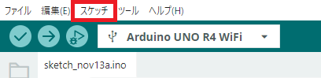<br>

2. 「デバッグに最適化」を押下する。<br>
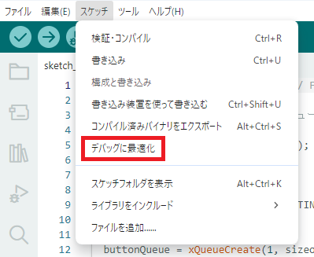<br>

3. 画面上部の「ツール」タブを押下する。<br>
<br>

4. 「書き込み装置」を押下する。<br>
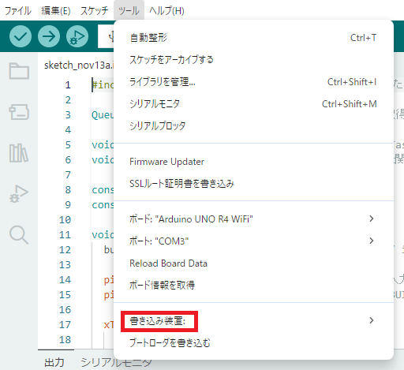<br>

5. 「ARM CMSIS-DAP compatible」を押下する。<br>
<br>

6. 画面左上部の「検証」ボタンを押下する。<br>
<br>

7. 画面左上部の「書き込み」ボタンを押下する。<br>
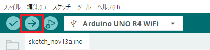<br>

8. 画面左上部の「デバッグの開始」ボタンを押下する。<br>
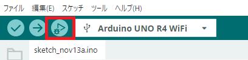<br>

9. 画面左部から「デバッグ」タブが開き、青丸の数字1がついていることを確認する。<br>
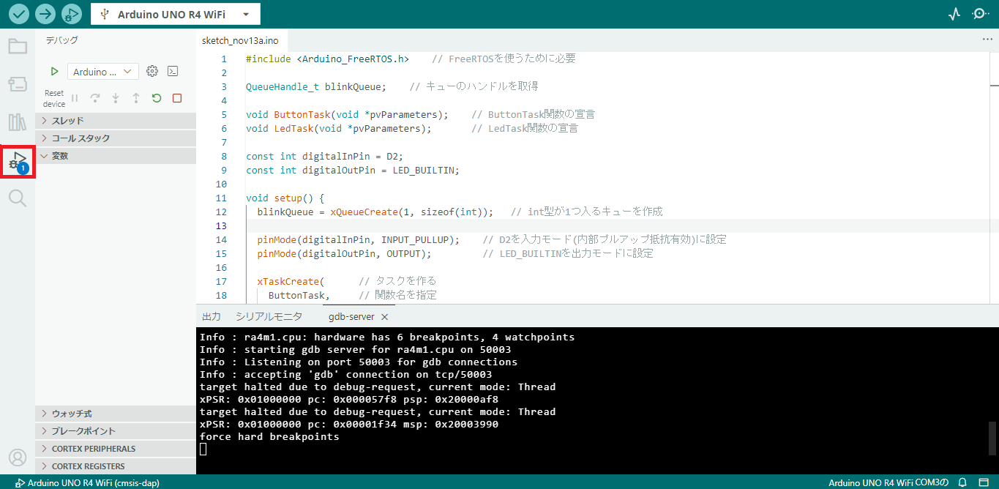<br>

> 確認：画面左部のデバッグのアイコンに青丸の数字1がつき、デバッグが開始していることが確認できる。<br>

### 6.3 ブレークポイント・ステップ実行
この節では、ブレークポイントの付与とステップ実行を行う。
1. 実行を止めたい行の行番号の左側を押下することで、ブレークポイントを付与する。<br>
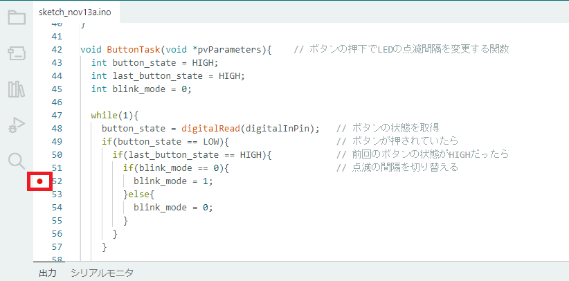<br>

2. 画面左上部の「デバッグの開始」ボタンを押下する。<br>
<br>

3. 画面左部の「デバッグ」タブからステップオーバーボタンを押下する。<br>
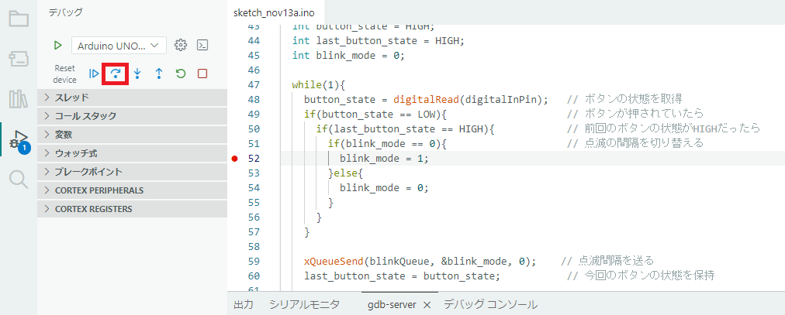<br>

> 確認：ブレークポイントを付与した箇所で実行が止まり、手順3.で次の行が実行されることが確認できる。<br>

### 6.4 変数・メモリ・レジスタの確認
この節では、デバッガによる変数・メモリ・レジスタの確認を行う。
1. 書き込みをした際に Arduino IDE の画面下部の「出力」タブに出力されるメモリ使用量を確認する。<br>
<br>

2. 実行を止めたい行の行番号の左側を押下することで、ブレークポイントを付与する。<br>
<br>

3. 画面左上部の「デバッグの開始」ボタンを押下する。<br>
<br>

4. 画面左側の「デバッグ」タブから「変数」タブを押下する。<br>
<br>

5. 「変数」タブ内の「Local」タブを押すことで、実行中の関数内のローカル変数を確認する。<br>
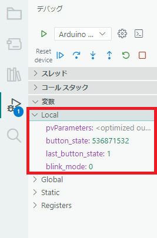<br>

6. 「変数」タブ内の「Global」タブを押すことで、グローバル変数を確認する。<br>
<br>

7. 「変数」タブ内の「Static」タブを押すことで、Static変数を確認する。<br>
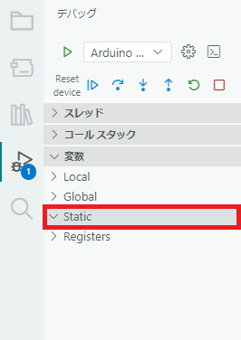<br>

8. 「変数」タブ内の「Registers」タブを押すことで、レジスタを確認する。<br>
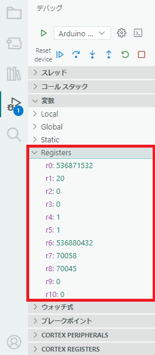<br>

> 確認：変数・メモリ・レジスタを確認することができる。<br>
> 注意：メモリを確認する際、出力タブが閉じている場合がある。その場合は再度書き込みを行うことで確認できる。

### 6.5 シリアル出力によるデバッグ
この節では、シリアル出力によるデバッグを行う。<br>
今回は「5.3 題材6」のコードをもとに、実行がどこまで進んでいるかをSerial関数で確認する。
1. 題材6のコードを以下のように書き換える。
    ```c
    #include <Arduino_FreeRTOS.h>    // FreeRTOSを使うために必要

    QueueHandle_t blinkQueue;    // キューのハンドルを取得

    void ButtonTask(void *pvParameters);    // ButtonTask関数の宣言
    void LedTask(void *pvParameters);       // LedTask関数の宣言

    const int digitalInPin = D2;
    const int digitalOutPin = LED_BUILTIN;
    const int boud = 9600;

    void setup() {
      Serial.begin(boud);
      delay(1000);
      Serial.println("start setup");

      blinkQueue = xQueueCreate(1, sizeof(int));   // int型が1つ入るキューを作成

      pinMode(digitalInPin, INPUT_PULLUP);    // D2を入力モード(内部プルアップ抵抗有効)に設定
      pinMode(digitalOutPin, OUTPUT);         // LED_BUILTINを出力モードに設定

      xTaskCreate(      // タスクを作る
        ButtonTask,     // 関数名を指定
        "ButtonTask",   // タスクの名前
        128,            // タスクのスタックサイズ
        NULL,           // タスクに渡す引数
        2,              // タスクの優先度
        NULL            // 作成したハンドルの格納場所
      );

      Serial.println("create ButtonTask");

      xTaskCreate(      // タスクを作る
        LedTask,        // 関数名を指定
        "LedTask",      // タスクの名前
        128,            // タスクのスタックサイズ
        NULL,           // タスクに渡す引数
        1,              // タスクの優先度
        NULL            // 作成したハンドルの格納場所
      );

      Serial.println("create LedTask");

      vTaskStartScheduler();    // タスクを実行
    }

    void loop(){
      // 使用しない
    }

    void ButtonTask(void *pvParameters){    // ボタンの押下でLEDの点滅間隔を変更する関数
      Serial.println("start ButtonTask");

      int button_state = HIGH;
      int last_button_state = HIGH;
      int blink_mode = 0;

      while(1){
        button_state = digitalRead(digitalInPin);   // ボタンの状態を取得
        if(button_state == LOW){                    // ボタンが押されていたら
          if(last_button_state == HIGH){            // 前回のボタンの状態がHIGHだったら
            if(blink_mode == 0){                    // 点滅の間隔を切り替える
              blink_mode = 1;
              Serial.println("blink_mode 1");
            }else{
              blink_mode = 0;
              Serial.println("blink_mode 0");
            }
          }
        }

        xQueueSend(blinkQueue, &blink_mode, 0);    // 点滅間隔を送る
        last_button_state = button_state;           // 今回のボタンの状態を保持

        vTaskDelay(pdMS_TO_TICKS(10));              // タスクを待ち状態にする
      }
    }

    void LedTask(void *pvParameters){   // LEDを点滅させる関数
      Serial.println("start LedTask");

      int blink_mode = 0;
      int led_time = 500;
      int led_state = LOW;

      while(1){
        xQueueReceive(blinkQueue, &blink_mode, 0);   // 送られた点滅間隔を受け取る

        if (blink_mode == 0){     // 受け取った点滅間隔から待ち時間を定める
          led_time = 500;
        }else{
          led_time = 100;
        }

        if (led_state == HIGH){   // LEDの状態を切り替える
          led_state = LOW;
        }else{
          led_state = HIGH;
        }

        digitalWrite(digitalOutPin, led_state);   // LEDを点灯消灯させる
        vTaskDelay(pdMS_TO_TICKS(led_time));      // 定めた時間待機する
      }
    }
    ```
6. 画面左上部の「検証」ボタンを押下する。<br>
<br>

7. 画面左上部の「書き込み」ボタンを押下する。<br>
<br>

8. シリアルモニタにデバッグ文が表示されることを確認する。<br>
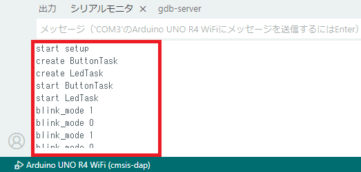<br>

> 確認：シリアルモニタに「start setup」「create ButtonTask」「create LedTask」「start ButtonTask」「start LedTask」が表示され、その後ボタンを押すたびに「blink_mode」の値が1と0で切り替わることが確認できる。

## 7. トラブルシューティング

| 症状 | 原因 | 対処 |
|---|---|---|
| ボードにプログラムを書き込めない | 書き込み時のタイムアウト | ボードのリセットボタンをすばやく2回押してボードをリセットする。 |
| デバッグが開始できない | すでにほかのデバッグが実行中 | 実行中のデバッグをすべて終了し再度デバッグの開始ボタンを押下する。 |
| デバッグのステップ実行が正常に動かない | コードをデバッグに最適化しないことによる処理タイミングのずれ | 画面上部「ツール」タブから「デバッグに最適化」を押下し、再度プログラムの検証、書き込み、デバッグの開始を行う。 |
| デバッグのステップ実行時に行が強調表示されない | フォルダに日本語が含まれていることによる動作不備 | 日本語の含まれないフォルダに移動する。 |

## 8. 参考資料

- Arduino UNO R4 WiFi ハードウェア仕様<br>
https://docs.arduino.cc/hardware/uno-r4-wifi/

- Arduino プログラミング言語仕様<br>
https://docs.arduino.cc/language-reference/

- Arduino UNO R4のFspTimerライブラリの使い方<br>
https://qiita.com/yasuhiro-k/items/93efb640aa12f3db9086

- Arduino公式 GitHub FspTimer.cpp（関数の実装）<br>
https://github.com/arduino/ArduinoCore-renesas/blob/main/cores/arduino/FspTimer.cpp

- Arduino公式 GitHub FspTimer.h（クラス定義）<br>
https://github.com/arduino/ArduinoCore-renesas/blob/main/cores/arduino/FspTimer.h

- FreeRTOS公式リファレンス<br>
https://www.freertos.org/Documentation/00-Overview

- Arduino UNO R4 WiFi のデバッグ<br>
https://docs.arduino.cc/tutorials/uno-r4-wifi/debugger/

<!-- ボード独自の追加章がある場合は、ここから「## 9. 〜」として追加する -->

<!--
  記述ルール(書きぶりを全章でそろえる)
  1. 見出し:章は「## 1. 開発環境構築」、節は「### 1.1 ツールのインストール」の形にする。
  2. 手順:番号付きリストで書き、1つの番号に1つの操作。文末は「〜する。」にそろえる。
  3. 確認:手順のあとに「> 確認:〜れば成功」と、成功したかどうかの判断方法を書く。
  4. 注意:まちがえやすい所は「> 注意:〜」と書く。
  5. 画像:画面操作にはスクリーンショットを付ける。images/ に置き、名前は担当番号から始める(例:p1_ext.png)。
  6. 図:処理の流れやタスクの関係は Mermaid で書く。配線は図か写真で、ピン番号と信号名を書く。
  7. プログラム:手順書の中にコードブロックで書き、日本語のコメントを付ける。
  8. バージョン:ツールと SDK のバージョンを書く。
  9. 用語:同じものは同じことばで書く。英数字は半角で、日本語との間に半角スペースを入れる。
  10. つまずいた点:第7章に必ず記録する。
-->